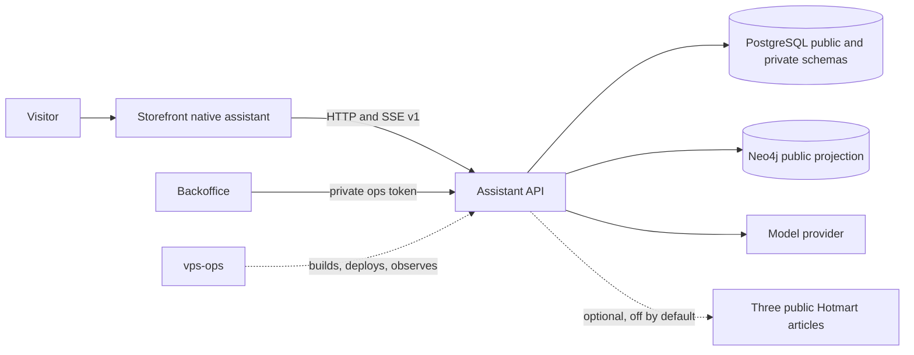
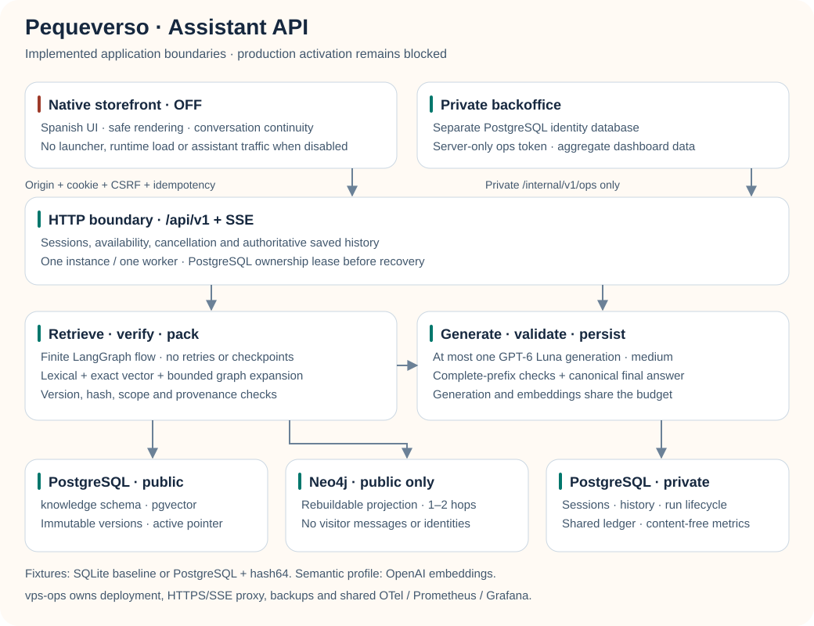

<div align="center">
  <h1>Pequeverso Assistant API</h1>
  <p>Advisory, read-only shopping assistant backend for the Pequeverso storefront, grounded in code.</p>
  <a href="https://github.com/gonzalomartinperez/pequeverso-assistant-api/actions/workflows/ci.yml"></a>
  <a href="https://github.com/gonzalomartinperez/pequeverso-assistant-api/releases"></a>
  <a href="LICENSE"></a>
</div>

## Why

Adult buyers ask what the Pequeverso kits include, which one fits their child and how the
published scope compares. This API answers those questions for the storefront's native
assistant and then points to the storefront and Hotmart for checkout. It is advisory and
read-only: it has no cart, order, payment, refund or account tools.

Grounding is enforced in code. The model names catalog ids; the server resolves them against
the catalog exported from the storefront and applies the answer rules, so every product, link
and price shown is server-validated. The native assistant answers in neutral Latin American
Spanish ([ADR-0006](docs/decisions/ADR-0006-native-spanish-compatible-policy.md)).

## Highlights

- Versioned HTTP and SSE contract for the storefront, with exported artifacts in
  [`contracts/`](contracts/manifest.json) and a drift check in CI.
- Grounded answers: ids resolved against the catalog, prices withheld when unverified, one
  accountable generation per turn and no automatic model retries.
- Public GraphRAG: lexical, vector and bounded graph retrieval behind a finite LangGraph flow
  ([graph retrieval](docs/explanation/graph-retrieval.md)).
- Fixture mode by default: the full pipeline runs deterministically with no credentials.
- Private, content-free operations summary for the backoffice; tracing and analytics are opt-in.
- Layer rules, ratchets and a scorecard keep quality measurable ([Quality](#quality)).

## Architecture



<picture>
  <source media="(prefers-color-scheme: dark)" srcset="docs/explanation/architecture/system-dark.svg">
  
</picture>

Domain and application code use the standard library only; adapters hold SQL, Cypher, the
LangGraph stack and provider SDKs, and only `bootstrap` wires concrete classes. Details:
[architecture](docs/explanation/architecture.md), [diagram sources](docs/explanation/architecture/README.md).

## Quickstart

Credential-free fixture profile (versions come from [`pyproject.toml`](pyproject.toml) and
[`.python-version`](.python-version)):

```bash
uv sync --locked
uv run uvicorn app.main:app --reload --port 8000   # fixture provider, bundled catalog, ./data/
```

The full local check mirrors CI:

```bash
just check
```

## Usage

Open a session; the response carries `csrf_token` and sets the session cookie. Every mutation
needs an allowlisted `Origin` header ([API contract](docs/reference/api-contract.md)):

```bash
curl -s -c /tmp/j -H 'Origin: http://localhost:3000' -H 'Content-Type: application/json' \
  -X POST localhost:8000/api/v1/session -d '{}'
```

Ask a question with that token and a unique idempotency key; the answer streams as SSE
(`run.started`, `message.delta`, then the authoritative `message.completed`):

```bash
curl -N -b /tmp/j -H 'Origin: http://localhost:3000' -H 'Content-Type: application/json' \
  -H 'X-CSRF-Token: <csrf_token>' -H 'Idempotency-Key: local-0001' \
  -X POST localhost:8000/api/v1/messages -d '{"content":"¿Qué incluye el kit?"}'
```

Example payloads live in [`contracts/examples/`](contracts/examples/session.created.json) (for
instance [`stream.recommendation.sse`](contracts/examples/stream.recommendation.sse)). Captures
of the native assistant are in [`docs/verification/assistant/`](docs/verification/assistant/2026-10-18/README.md).

## Quality

- [Scorecard](docs/master-plan/scorecard.md): axes and thresholds tracked per repository.
- [`ratchets/`](ratchets/): committed baselines for lint, complexity, coverage, mutation,
  retrieval, golden set and performance; they can only improve.
- [Evaluation](docs/reference/evaluation.md): fixture suites check the pipeline and guards;
  real-model reports are separate and need owner authorization.
- [CI profile](docs/reference/ci.md): static analysis, import-layer contracts, type checks,
  tests, contract drift, container smoke, secret and vulnerability scans.

## Documentation

The index is [`docs/README.md`](docs/README.md), organized with Diátaxis:

- Tutorials: none yet; the index tracks them.
- How-to: [`docs/how-to/`](docs/how-to/) for operations and dependency updates.
- Reference: [`docs/reference/`](docs/reference/) for the API contract, catalog, deployment and CI.
- Explanation: [`docs/explanation/`](docs/explanation/) and [decisions](docs/decisions/).
- Evidence and plan: [`docs/verification/`](docs/verification/) and [`docs/master-plan/`](docs/master-plan/README.md).

## Ecosystem

| Repository | Role |
| --- | --- |
| `pequeverso` | Storefront; consumes the public v1 contract through its native assistant |
| `pequeverso-assistant-api` | This repository: the assistant backend |
| `pequeverso-backoffice` | Private operations consumer of the ops summary |
| `vps-ops` | Private; builds, deploys and observes the services |
| `engineering-standards` | Shared CI workflows, templates and standards |

## Contributing and security

Read [CONTRIBUTING.md](CONTRIBUTING.md) for the check command and branch flow. Report
vulnerabilities as described in [SECURITY.md](SECURITY.md). Questions go through
[SUPPORT.md](SUPPORT.md); participation follows the [Code of Conduct](CODE_OF_CONDUCT.md).

## Scope and limits

- Not deployed: the storefront widget stays disabled by flag until the deployment gates in
  [deployment contract](docs/reference/deployment-contract.md) are verified.
- Fixture mode is the default; paid model calls and live evaluations need the owner's
  explicit authorization.
- Verification evidence in `docs/verification/` is dated and does not authorize activation.

## License

Software is under the [MIT License](LICENSE); brand, content, media and data are reserved,
see [NOTICE.md](NOTICE.md).
