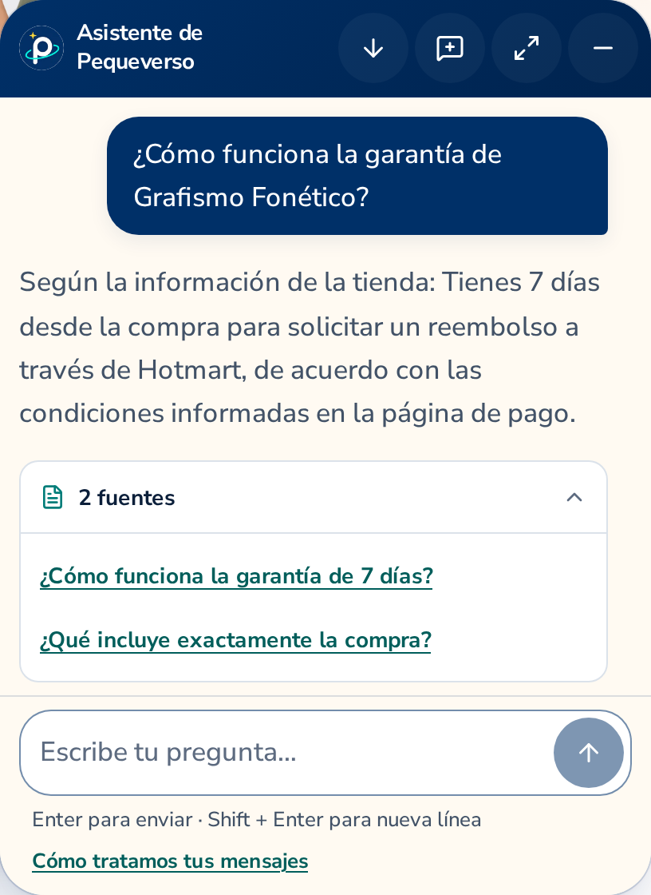
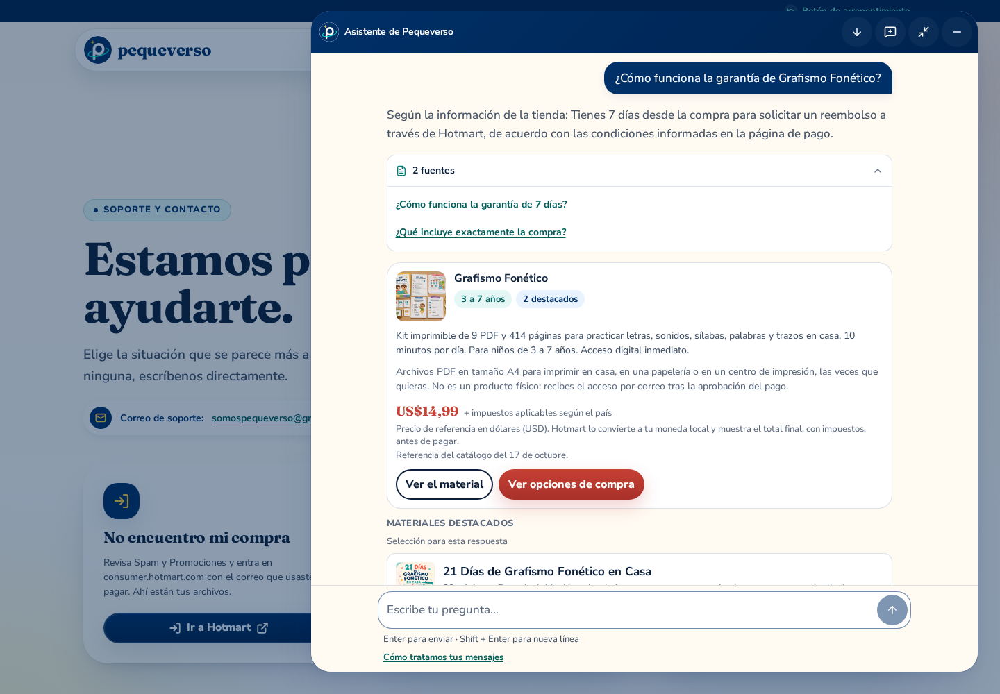
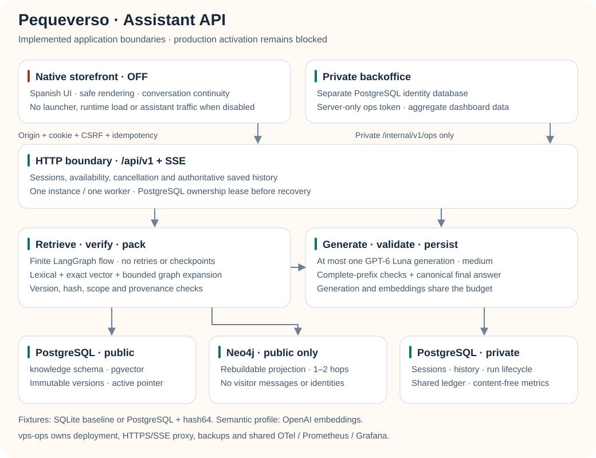

# Pequeverso · Assistant API


Backend of the Pequeverso shopping assistant: an **advisory, read-only** AI assistant that helps
adult buyers understand the Grafismo Fonético kit and the separately recommended affiliate
course, compare their published scope and reach the appropriate storefront flow. Public
repository; its owner-authored software is MIT-licensed ([license](LICENSE),
[scope and reserved material](NOTICE.md)). `main` is the default and release branch;
development happens on `develop`.

- Python 3.14.8, FastAPI and uv; PostgreSQL/pgvector with a public Neo4j projection in the
  production profile; OpenAI Responses (`gpt-6-luna`) behind a provider port. The default
  credential-free local profile remains deterministic fixtures with SQLite.
- Versioned commercial GraphRAG combines lexical, vector and bounded graph retrieval.
  LangGraph orchestrates a finite retrieve → answer flow; LangChain Documents carry verified
  public passages. LangSmith runtime tracing stays off; offline synthetic evaluation is separate.
- Versioned HTTP/SSE contract (v1, revision 1.5) for the storefront's native assistant, which
  calls the API cross-origin; private, token-protected operations summary for the backoffice
  (`pequeverso-backoffice`, renamed from `pequeverso-assistant-backoffice`; the original
  chat repository was `pequeverso-assistant-web`).
- The native assistant presents only neutral Latin American Spanish ("tú"), without a language
  selector. Every new native turn sends `response_language: "es"` and requires API revision1.4
  or later. Earlier API clients remain compatible when this field is absent, including their
  legacy ES/EN behavior and stored history; the existing wire enum is preserved.
- `gpt-6-luna` at **medium** reasoning effort when paid use is authorized; budget USD 10/month
  (configurable) with atomic reservations and confirmed / estimated / pending spend.
- Optional [official Hotmart procedure evidence](docs/official-web-evidence.md) is server-owned,
  bounded to three public articles and disabled by default; no autonomous searches or buyer-account tools.
- Grounded in a catalog exported from the storefront at a pinned commit; every product,
  link and price shown is server-validated.
- [Architecture and resource ownership](docs/architecture.md) keep SDK/HTTP/storage details outside
  the use cases. [Engineering standards](docs/engineering-standards.md) define review evidence,
  four-session ownership, reproducible locks/digests and supported-version policies.

The commercial goal is an informed purchase: answer the adult's question, explain the fit and
offer the authorized next step when relevant. Evidence and budget constraints remain binding;
a completed response or a valid citation does not establish semantic correctness. The storefront
assistant stays **disabled in publishable builds** until the VPS and activation gates are verified.

## The native assistant in use

These are genuine local captures of the refined Spanish interface, using an isolated **fixture
API**. They show layout and interaction, not real-model quality or the deployed VPS. Production
remains disabled: no launcher, runtime load or assistant API traffic in the publishable build.

| Welcome and suggested questions | Answer and disclosed sources |
| :---: | :---: |
| [](docs/verification/native-assistant-2026-10-17/desktop-welcome.png) | [](docs/verification/native-assistant-2026-10-17/desktop-answer-sources.png) |
| Mobile conversation and input | Expanded conversation |
| [](docs/verification/native-assistant-2026-10-17/mobile-conversation.png) | [](docs/verification/native-assistant-2026-10-17/desktop-expanded.png) |

Open each original PNG for full detail. The [capture manifest](docs/verification/native-assistant-2026-10-17/manifest.json)
retains its actual UI/fixture API revisions; copying these reviewed assets from storefront
`c9aaa99169f3db16dcea354734aea866f3a86bef` does not relabel them as a later API build.
The [historical real-model gallery](docs/verification/native-assistant-2026-10-12/README.md)
separately preserves the earlier GPT-6 Luna medium session, history and completed-request replay.
Neither gallery establishes the quality of the new semantic retrieval profile or production readiness.

## System at a glance

<p align="center">
<picture>
  <source media="(prefers-color-scheme: dark)" srcset="docs/architecture/system-dark.svg">
  
</picture>
</p>

[Open full-size diagram](docs/architecture/system-light.svg) ·
[Dark version](docs/architecture/system-dark.svg) ·
[Editable relationships and SVG provenance](docs/architecture/README.md).

The production API owns separate PostgreSQL public-catalog and private-application schemas;
Neo4j is a rebuildable public projection. The backoffice owns a separate PostgreSQL identity
database. The credential-free default is SQLite/fixture. Authorized semantic retrieval uses
OpenAI embeddings with separate accounting; each answered turn has at most one generation; optional Hotmart retrieval reads only three fixed official articles and
is disabled by default. OTLP, private metrics and Grafana are integration responsibilities for
vps-ops, not evidence of deployment, VPS capacity or production readiness.

| Boundary | Responsibility |
| --- | --- |
| Storefront | Conversation UI, safe rendering and continuity; Hotmart checkout and existing consent remain unchanged |
| API | Sessions, language selection, grounding, streaming, cancellation, validation and budget reservations |
| PostgreSQL | Separate public knowledge and private conversations/accounting schemas and capability roles |
| Neo4j | Public-only, versioned projection with canonical PostgreSQL provenance checks |
| SQLite | Isolated fixture profile and explicit non-destructive historical import |
| Backoffice | OAuth and roles on PostgreSQL; reads private, content-free operations data server-side |
| vps-ops | Publishes and deploys selected images; owns reverse proxy, Coolify, shared monitoring and backups |

There are no payment/order tools, routing LLM, generated SQL/Cypher, Redis or automatic model
retries. Structured catalog facts remain mandatory. Verified passages and old model-context
text fit the unchanged 24KB bound. Component retrieval, semantic quality, HTTP correctness and
conversion are different measurements. See [GraphRAG evidence](docs/graph-retrieval.md) and
[operator jobs, roles and remaining deployment gates](docs/knowledge-operations.md).

## One question, one accountable generation

The [editable request sequence](docs/architecture/request-flow.mmd) details session/CSRF,
one accountable generation, retrieval, canonical validation and terminal persistence. The
centered system diagram above shows the same application and data boundaries.

Provider credentials exist only in the backend. Fixture is the default; real evaluations require
current owner authorization, private configuration and one shared conservative budget. Model
errors do not trigger a substitute model or an automatic generation retry.

Only complete sentence/paragraph prefixes passing the same bounded commercial checks as the
final answer can stream. A later invalid claim can still replace an earlier checked prefix;
the client must render the authoritative `message.completed`. Catalog guarantee checks apply
even when optional Hotmart retrieval is disabled or unavailable. These deterministic checks
do not establish complete semantic correctness or citation entailment.

Explicit resource page counts are checked against structured catalog metadata. Request packing
preserves products/resources and merchant policies, trims only model-context history and optional
documents when needed, and leaves saved conversations unchanged. Citations resolve only to
evidence actually sent in that generation. The [post-tool report](docs/verification/post-tools-2026-10-13.md)
preserves the original halted run separately from subsequent fixes and revalidation; completion
and agent review are distinct from semantic correctness and human acceptance.

## Quick start (clean checkout, no credentials)

```
uv sync --frozen
uv run uvicorn app.main:app --reload --port 8000      # fixture mode, bundled catalog, ./data/
curl -s -c /tmp/j -H 'Origin: http://localhost:3000' -H 'Content-Type: application/json' \
  -X POST localhost:8000/api/v1/session -d '{}'
```

Ask a question (replace `<csrf>` with `csrf_token` from the response):

```
curl -N -b /tmp/j -H 'Origin: http://localhost:3000' -H 'Content-Type: application/json' \
  -H 'X-CSRF-Token: <csrf>' -H 'Idempotency-Key: local-0001' \
  -X POST localhost:8000/api/v1/messages -d '{"content":"¿Qué incluye el kit?"}'
```

## Verify

```
uv run ruff check . && uv run ruff format --check . && uv run mypy
uv run pytest                                   # unit, HTTP/SSE contract, real-socket streaming, SQLite, budget races, evals
uv run python -m contracts.export --check       # pinned contract artifacts are current
uv run python scripts/evaluate_retrieval.py
uv run python scripts/evaluate_conversations.py # fixture safety + guards (no paid calls)
scripts/smoke_container.sh                      # image: non-root, read-only, SSE, restart persistence
```

## Documentation

| Topic | Doc |
|---|---|
| Public contract (sessions, SSE, references, freshness, errors, languages) and private ops API | `docs/api-contract.md` + `contracts/`; handoffs `docs/handoffs/storefront-transition.md` (native assistant) and `docs/handoffs/backoffice.md` (backoffice) |
| Architecture and decisions | `docs/architecture.md`, `docs/decisions/` |
| Security, privacy, retention | `docs/security.md` |
| Catalog source, sync, freshness | `docs/catalog.md`, `docs/graph-retrieval.md`, `docs/knowledge-operations.md` |
| Evaluation and live procedure | [Procedures](docs/evaluation.md), [historical real-model evidence](docs/verification/real-model-2026-10-12.md), [post-tool verification and limits](docs/verification/post-tools-2026-10-13.md) |
| Optional private telemetry, metrics and traces | `docs/observability/README.md` |
| Deployment handoff (vps-ops/Coolify) | `docs/deployment-contract.md` |
| Dependency updates and manual review | `docs/dependency-updates.md` |
| Reference adoption (portfolio-assistant-api) | `docs/reference-adoption.md` |
| Storefront transition, vps-ops handoff, open business questions | `docs/handoffs/storefront-transition.md`, `docs/handoffs/vps-ops.md`, `docs/business-questions.md` |
| Agent instructions and skills | `AGENTS.md`, `.agents/skills/` |

## Verification and operational limits

- Fixture suites verify the pipeline, guards and persistence; they do not measure model quality.
  Real model reports must distinguish usage-derived cost estimates from invoices and retain
  interrupted requests. See [evaluation](docs/evaluation.md).
- A catalog's Git revision proves provenance, not deployment or the final merchant checkout
  total. Expired prices are withheld. See [catalog freshness](docs/catalog.md).
- Logical deletion does not guarantee erasure from database pages, WAL or backups. Retention,
  encrypted off-server backup and an operational restore drill remain activation gates.
- Containers are non-root, read-only and resource-limited. Smoke the exact selected image,
  including active-stream shutdown; preserve the grace specified in the deployment contract.
- Prefer LTS branches where offered and supported stable releases elsewhere. Most libraries
  do not publish an LTS guarantee; pins, security review and reproducibility remain necessary.
- Python 3.14.8 is selected because the frozen GraphRAG dependencies lack a complete Python
  3.15 wheel set; no ad hoc source builds are required. Python does not use an official LTS label.
  LangGraph and LangChain 1.x do publish a release/support policy; do not group them with
  dependencies that make no LTS commitment. The selected Python
  OpenTelemetry SDK/exporter is 1.45.1; its locked tree includes three 0.66b1 beta packages.
  Prometheus 3.13 is the monitoring LTS target; Grafana and the collector have their own support
  and component-stability policies. vps-ops selects and deploys their final images.
  See the official [Python lifecycle](https://devguide.python.org/versions/),
  [Prometheus LTS schedule](https://prometheus.io/docs/introduction/release-cycle/),
  [Grafana policy](https://grafana.com/docs/grafana/latest/upgrade-guide/when-to-upgrade/) and
  [collector stability table](https://github.com/open-telemetry/opentelemetry-collector/blob/main/docs/component-stability.md).
- No build, screenshot or local test authorizes a deployment or production activation.

Task branches target `develop` through protected squash PRs. A release into `main` requires
separate owner authorization and a protected merge commit. The software license does not
authorize deployment or access to private data. Never commit secrets, private evaluations
or customer conversations.

Shared runtime/version acceptance: [runtime baseline](docs/runtime-baseline.md).

### Affiliate product coverage (2026-10-18)

The catalog now includes Grafismo Fonético and the separate third-party **Guía de Alimentación
para Bebés**, exported from storefront main `fd2f150fe2e08955b3817c3b18ff14dea920d74e`. The
course has no authorized published price, PDFs or page counts: those remain null. Its published
seven-day guarantee and affiliate disclosure stay product-scoped; the kit policy cannot transfer
to the course. Revision1.5 adds optional card kind/format/disclosure fields, with core defaults
for historical messages. See [catalog](docs/catalog.md) and [contract](docs/api-contract.md).
Fixture tests prove transport, grounded metadata, history and replay; they do not establish
real-model quality, a functioning affiliate redirect or readiness of an undeployed VPS.

## Software license

Owner-authored software and technical documentation use the [MIT License](LICENSE).
Brand, commercial/product content, catalog datasets, media, private data and third-party
material are excluded; see [NOTICE.md](NOTICE.md). Existing third-party licenses and
attributions remain applicable. The runtime image carries both notices under `/app/`.
