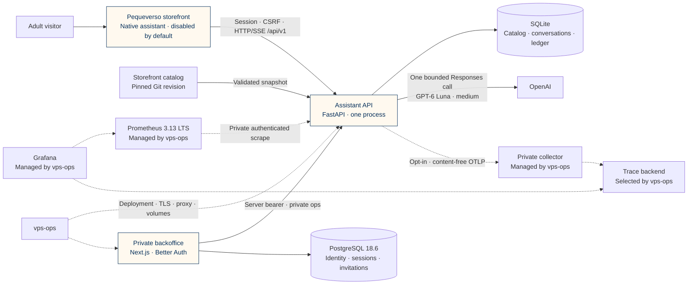

# Pequeverso · Assistant API


Backend of the Pequeverso shopping assistant: an **advisory, read-only** AI assistant that helps
adult buyers understand the Grafismo Fonético kit, choose where to start, compare what is
included and reach the storefront's purchase flow. Public repository; no license is granted
(all rights reserved). `main` is the default and release branch; development happens on `develop`.

- Python 3.14.8, FastAPI, uv; SQLite (single process); OpenAI Responses (`gpt-6-luna`) behind a
  provider port; a deterministic **fixture provider is the default**.
- Versioned HTTP/SSE contract (v1, revision 1.4) for the storefront's native assistant, which
  calls the API cross-origin; private, token-protected operations summary for the backoffice
  (`pequeverso-assistant-backoffice`, formerly `pequeverso-assistant-web`).
- The native assistant presents only neutral Latin American Spanish ("tú"), without a language
  selector. Every new native turn sends `response_language: "es"` and requires API revision1.4
  or later. Earlier API clients remain compatible when this field is absent, including their
  legacy ES/EN behavior and stored history; the existing wire enum is preserved.
- `gpt-6-luna` at **medium** reasoning effort when paid use is authorized; budget USD 10/month
  (configurable) with atomic reservations and confirmed / estimated / pending spend.
- Grounded in a catalog exported from the storefront at a pinned commit; every product,
  link and price shown is server-validated.

The commercial goal is an informed purchase: answer the adult's question, explain the fit and
offer the authorized next step when relevant. Evidence and budget constraints remain binding;
a completed response or a valid citation does not establish semantic correctness. The storefront
assistant stays **disabled in publishable builds** until the VPS and activation gates are verified.

## System at a glance



| Boundary | Responsibility |
| --- | --- |
| Storefront | Conversation UI, safe rendering and continuity; Hotmart checkout and existing consent remain unchanged |
| API | Sessions, language selection, grounding, streaming, cancellation, validation and budget reservations |
| SQLite | Isolated conversations and accounting; public catalog snapshots are separate from private messages |
| Backoffice | OAuth and roles on PostgreSQL; reads private, content-free operations data server-side |
| vps-ops | Publishes and deploys selected images; owns reverse proxy, Coolify, shared monitoring and backups |

There are no payment/order tools, embeddings, Neo4j, Redis or a graph orchestration framework.
The complete authorized catalog fits in the evidence budget; lexical ranking is measured separately.

## One question, one accountable generation

```mermaid
sequenceDiagram
  participant UI as Native assistant
  participant API as HTTP boundary
  participant App as Chat service
  participant DB as SQLite
  participant AI as GPT-6 Luna
  UI->>API: Session + Origin + CSRF + idempotency key
  API->>App: Validated visitor turn
  App->>DB: Claim request + reserve worst-case spend
  App->>AI: Authorized evidence + history, medium, no retries
  AI-->>App: Structured deltas + usage
  App-->>UI: Provisional message.delta
  App->>App: Resolve references + validate commercial claims
  App->>DB: Persist authoritative answer + settle known usage
  App-->>UI: message.completed + run.completed
  Note over App,DB: Cancellation or missing usage keeps its reservation; partial answers are not stored
```

Provider credentials exist only in the backend. Fixture is the default; real evaluations require
current owner authorization, private configuration and one shared conservative budget. Model
errors do not trigger a substitute model or an automatic generation retry.

## Quick start (clean checkout, no credentials)

```
uv sync --frozen
uv run uvicorn app.main:app --reload --port 8000      # fixture mode, bundled catalog, ./data/
curl -s -c /tmp/j -H 'Origin: http://localhost:3000' -H 'Content-Type: application/json' \
  -X POST localhost:8000/api/v1/session -d '{}'
```

Ask a question (replace `<csrf>` with `csrf_token` from the response):

```
curl -N -b /tmp/j -H 'Origin: http://localhost:3000' -H 'Content-Type: application/json' \
  -H 'X-CSRF-Token: <csrf>' -H 'Idempotency-Key: local-0001' \
  -X POST localhost:8000/api/v1/messages -d '{"content":"¿Qué incluye el kit?"}'
```

## Verify

```
uv run ruff check . && uv run ruff format --check . && uv run mypy
uv run pytest                                   # unit, HTTP/SSE contract, real-socket streaming, SQLite, budget races, evals
uv run python -m contracts.export --check       # pinned contract artifacts are current
uv run python scripts/evaluate_retrieval.py
uv run python scripts/evaluate_conversations.py # fixture safety + guards (no paid calls)
scripts/smoke_container.sh                      # image: non-root, read-only, SSE, restart persistence
```

## Documentation

| Topic | Doc |
|---|---|
| Public contract (sessions, SSE, references, freshness, errors, languages) and private ops API | `docs/api-contract.md` + `contracts/`; handoffs `docs/handoffs/storefront-transition.md` (native assistant) and `docs/handoffs/backoffice.md` (backoffice) |
| Architecture and decisions | `docs/architecture.md`, `docs/decisions/` |
| Security, privacy, retention | `docs/security.md` |
| Catalog source, sync, freshness | `docs/catalog.md` |
| Evaluation and live procedure | [Procedures](docs/evaluation.md), [real-model evidence and limits](docs/verification/real-model-2026-10-12.md) |
| Optional private telemetry, metrics and traces | `docs/observability/README.md` |
| Deployment handoff (vps-ops/Coolify) | `docs/deployment-contract.md` |
| Dependency updates and auto-merge policy | `docs/dependency-updates.md` |
| Reference adoption (portfolio-assistant-api) | `docs/reference-adoption.md` |
| Storefront transition, vps-ops handoff, open business questions | `docs/handoffs/storefront-transition.md`, `docs/handoffs/vps-ops.md`, `docs/business-questions.md` |
| Agent instructions and skills | `AGENTS.md`, `.agents/skills/` |

## Verification and operational limits

- Fixture suites verify the pipeline, guards and persistence; they do not measure model quality.
  Real model reports must distinguish usage-derived cost estimates from invoices and retain
  interrupted requests. See [evaluation](docs/evaluation.md).
- A catalog's Git revision proves provenance, not deployment or the final merchant checkout
  total. Expired prices are withheld. See [catalog freshness](docs/catalog.md).
- Logical deletion does not guarantee erasure from SQLite bytes, WAL or backups. Retention,
  encrypted off-server backup and an operational restore drill remain activation gates.
- Containers are non-root, read-only and resource-limited. Smoke the exact selected image,
  including active-stream shutdown; preserve the grace specified in the deployment contract.
- Prefer LTS branches where offered and supported stable releases elsewhere. Most libraries
  do not publish an LTS guarantee; pins, security review and reproducibility remain necessary.
- Python 3.14 is a supported stable branch, not an official LTS line. The selected Python
  OpenTelemetry SDK/exporter is 1.45.1; its locked tree includes three 0.66b1 beta packages.
  Prometheus 3.13 is the monitoring LTS target; Grafana and the collector have their own support
  and component-stability policies. vps-ops selects and deploys their final images.
  See the official [Python lifecycle](https://devguide.python.org/versions/),
  [Prometheus LTS schedule](https://prometheus.io/docs/introduction/release-cycle/),
  [Grafana policy](https://grafana.com/docs/grafana/latest/upgrade-guide/when-to-upgrade/) and
  [collector stability table](https://github.com/open-telemetry/opentelemetry-collector/blob/main/docs/component-stability.md).
- No build, screenshot or local test authorizes a deployment or production activation.

Task branches target `develop` through protected squash PRs. A release into `main` requires
separate owner authorization and a protected merge commit. Public repository, all rights reserved;
no license is granted. Never commit secrets, private evaluations or customer conversations.
