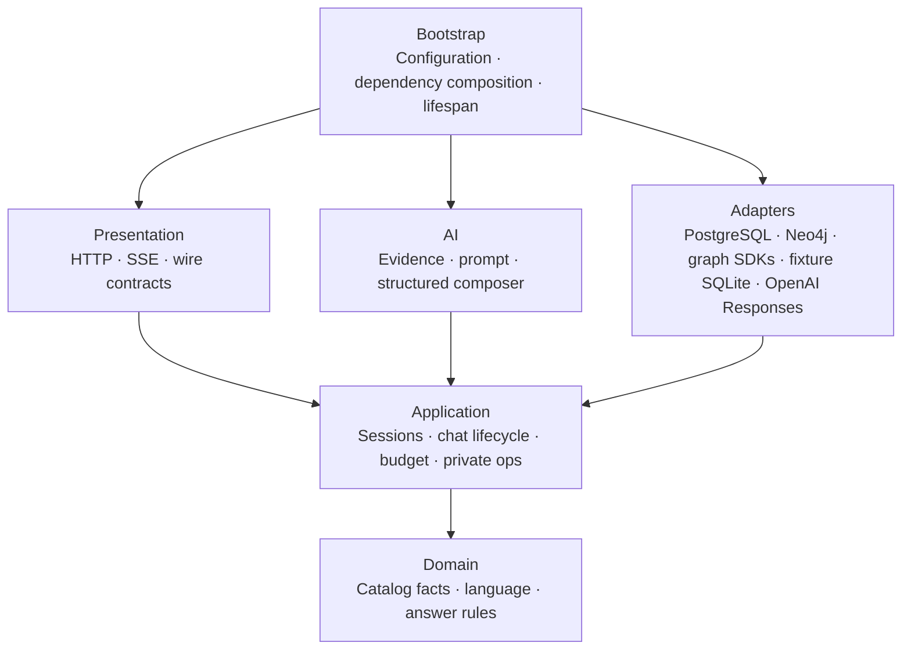

# Architecture

A modular monolith with hexagonal boundaries, sized for one small catalog and one process.



Arrows show code dependencies, not network traffic. Domain and application remain standard-library
only; concrete integrations are composed in bootstrap. Instrumentation must preserve those
boundaries and export no messages, prompts, identities or credentials.

```
storefront (native assistant, cross-origin, CORS + cookie + CSRF) ──/api/v1──► presentation
backoffice server (bearer token, private network) ──/internal/v1/ops──►   (FastAPI routes, SSE, middleware)
                                                     │
                                                     ▼
                              application (sessions, chat run lifecycle, budget, rate limits,
                                           answer validation, catalog activation) ── ports
                                                     │                                  ▲
                                   ai (evidence, prompt, output parser, composer)       │
                                                     │                                  │
                               adapters: OpenAI Responses · PostgreSQL · Neo4j · bounded graph · fixture SQLite · catalog file/http
                                                     ▲
                                 bootstrap (settings, composition root, lifespan, logging)
```

| Layer | Path | May import |
|---|---|---|
| domain | `app/domain` | stdlib only: catalog facts, budget math, redaction, answer rules, errors |
| application | `app/application` | domain: use cases and `Protocol` ports |
| ai | `app/ai` | domain, application: grounding and the provider port |
| adapters | `app/adapters` | the above + validated SQL/driver, graph and provider SDKs |
| presentation | `app/presentation` | domain, application + FastAPI: wire models are the contract |
| bootstrap | `app/bootstrap` | everything: the only place that wires concrete classes |

`tests/test_architecture.py` checks declared imports with Python AST, including relative imports
and package aliases. SQL stays inside `adapters/sqlite` or `adapters/postgres`; Cypher/Neo4j
stay in `adapters/neo4j`, graph SDKs in `adapters/graph`. Model and embedding implementations
share `adapters/providers`; OpenAI SDK imports stay there or in bootstrap construction.
The concrete observability capability lives in `adapters/observability/telemetry.py`;
OpenTelemetry and Prometheus imports stay inside that package. The package contains the real
implementation and its normal package exports, rather than empty layer directories.
Provider consumers import the concrete modules in `adapters/providers`; the former flat provider
modules are removed after migrating all repository consumers. The observability package exports
the same classes and functions as its telemetry module without duplicating implementation.
Only the explicit offline import
adapter may read SQLite from the PostgreSQL adapter directory. Same-layer dependency cycles
and misplaced drivers have negative regression cases. These
exercise the actual layer gate. This is a static boundary check, not proof of arbitrary runtime
reflection or complete semantic correctness. The dependency direction follows
[Robert C. Martin's dependency rule](https://blog.cleancoder.com/uncle-bob/2012/08/13/the-clean-architecture.html)
and [Microsoft's application-core guidance](https://learn.microsoft.com/en-us/dotnet/architecture/modern-web-apps-azure/common-web-application-architectures):
framework and storage details remain outside the application core; our ports carry ordinary
Python values, not FastAPI requests, SDK responses or SQLite rows.

## Resource ownership

Bootstrap owns the SDK client it constructs. It passes only `ModelProvider` to the composer;
the client close callback stays in composition. An injected provider remains borrowed, so the
application never guesses or closes a caller-owned resource. Fixture mode acquires no OpenAI
client. No network or provider credential is needed to verify this ownership with fakes.

Lifespan registers cleanup before acquiring its private/public PostgreSQL pools and Neo4j driver
(or the SQLite fixture connection). It holds a dedicated PostgreSQL ownership connection before
recovering abandoned runs or reservations; a second instance cannot recover live work. Loss of
ownership blocks readiness and new admission without silent reacquisition. Shutdown first refuses
new work and drains response/run finalizers under the existing bound, preserving unknown spend;
then ownership and concrete resources close in reverse registered order. `AsyncExitStack`
ensures later cleanup still runs if an earlier close fails. The response adapter continues to
close each individual stream; that is distinct from closing the shared SDK connection pool.

```mermaid
sequenceDiagram
  participant Life as Bootstrap lifespan
  participant Runs as Active runs and response cleanup
  participant SDK as Owned provider client
  participant DB as Owned persistence
  participant OTel as Owned telemetry
  Life->>Runs: Refuse new work; cancel and drain
  Runs-->>Life: Persist terminal state and conservative spend
  Life->>SDK: Close once, after streams
  Life->>DB: Close connection and executor
  Life->>OTel: Flush and shut down
```

The lifecycle uses application-owned cleanup rather than depending on when a request-scoped
`yield` dependency happens to finish. FastAPI documents the interaction between
[streaming responses and dependency lifetime](https://fastapi.tiangolo.com/advanced/advanced-dependencies/).
The [official OpenAI application example](https://developers.openai.com/cookbook/examples/agents_api/apps/slack_bot/readme)
also separates completing active work from closing its client; the exact `close()` operation was
checked against our locked SDK. Tests cover owned/borrowed providers, migration acquisition
failure, cleanup exceptions, active fake SDK streams and the existing real HTTP/SSE SIGTERM test.
No change to the public HTTP/SSE contract or catalog is required.

Catalog validation remains a deliberate adapter boundary: the shared Pydantic parser rejects
malformed or unauthorized registry fields and maps them to domain values. Both file and HTTP
sources pass through it. Current evidence does not justify moving those models wholesale into
domain; another ingestion path would need equivalent validation and parity tests.

See [engineering standards](engineering-standards.md) for review, collaboration ownership and
reproducibility requirements.

## One turn

1. `POST /api/v1/messages` passes middleware in order: request context → CORS → origin policy →
   16 KiB body limit. It then checks the session cookie and CSRF token.
2. `ChatService.start` runs every check that can refuse the request, each as an HTTP error:
   - enabled, catalog present and runtime ownership alive
   - input size and page enum
   - idempotency claim (a replay returns the stored answer)
   - synchronized matching public PG/Neo knowledge before any query embedding
   - rate limits
   - card-number refusal (no model call)
   - contact-data redaction
   - history window (12 messages)
   - evidence and prompt preparation, with a byte-size bound
   - concurrency slot
   - worst-case budget reservation (atomic PostgreSQL transaction/advisory lock; SQLite fixture uses `BEGIN IMMEDIATE`)
   - storing the user message
3. The stream: the finite LangGraph adapter retrieves and verifies public chunks, repacks complete
   passages under the existing byte bound, then delegates to `GroundedComposer` for **one**
   generation. Embedding requests share the ledger but have separate purpose-tagged reservations.
   A known pre-generation failure settles generation usage to zero; possibly dispatched work
   without reported usage stays conservatively counted. LangChain Documents stay adapter-local;
   LangSmith runtime tracing is off even under ambient tracing environment variables.

    The strict JSON output is parsed
   incrementally. A bounded buffer validates cumulative complete sentence/paragraph prefixes
   with the same normalization and business checks as the final answer before `message.delta`.
   Ambiguous formatting, overflow and rejected prefixes are withheld, not forwarded raw.
4. On completion `finalize()` does three things:
   - resolves every product, resource, link and source id against the catalog
   - builds card metadata from catalog data only
   - applies the answer rules (and replaces the answer on a violation)

   Known usage is settled before any accepted canonical tail delta; the same finalized answer
   is stored and emitted as `message.completed` + `run.completed`. Cancellation and the existing
   deadline are checked before/after that tail; missing usage stays conservatively charged.
5. Cancellation (endpoint or disconnect), deadline and provider failures each end the stream with
   exactly one terminal event. `ClosingStreamingResponse` guarantees cleanup (slot, registry, run
   state) even when the client vanishes. Partial answers are never stored.

## Language, metrics and spend states

- `domain/language.py` decides the reply language (es/en, or unsupported) before the model call;
  the composer passes it as `reply_language`. Native `response_language: "es"` selects Spanish
  independently of locale/history; recognized explicit foreign-language reply requests get a
  Spanish-only local notice (no model call or reservation). Legacy omitted/null policy retains
  ES/EN selection and its bilingual unsupported-language notice. See ADR-0006.
- Every accepted or refused run writes one content-free row to `run_metrics` (outcome, failure
  code, model call yes/no, replaced, language, first-delta and total latency). Writing it is best
  effort: a failure is logged and never affects the answer. Retained 90 days.
- Ledger rows move `pending` → `settled` (provider usage, including on `response.incomplete`
  when usage is reported) or `unreported` (no usage: the reservation stays counted).
- `application/operations.py` builds the private ops summary from those two tables and the
  catalog state; `presentation/operations.py` serves it under `/internal/v1/ops`.

## Deliberate choices

- **PostgreSQL as production relational authority** (ADR-0009), with separate public/private
  schemas and capability roles. A dedicated session advisory lock enforces the supported single
  runtime before recovery. SQLite remains the fixture/historical import profile; no automatic
  destructive migration or permanent dual production engine is introduced.
- **Commercial GraphRAG with mandatory catalog facts** (ADR-0009). PostgreSQL lexical and exact
  vector search combine with bounded Neo4j public paths. Hash64 fixtures test mechanics;
  real semantic mode uses OpenAI `text-embedding-3-small` at 1536 dimensions. Catalog facts,
  source scope and freshness remain authoritative. No graph edge establishes a health benefit,
  price, availability or suitability. The historical no-embedding ADR-0002 describes the earlier
  baseline; it is not the current production-profile design.
- **Structured streaming + final validation** (ADR-0003). The stream is provisional; the final
  message is authoritative and validated.
- **Medium reasoning effort** for `gpt-6-luna` (owner decision; ADR-0004). Reasoning tokens are
  billed as output and count toward `max_output_tokens`, so the allowance is 4000 and the run
  deadline 60 s, both to be tuned from live usage reports.
- **Bounded graph orchestration, no autonomous tool loop**. LangGraph retrieve → answer has no
  retries, store, cache or checkpointer. No Redis, APOC, GDS, routing LLM, generated SQL/Cypher
  or unmeasured approximate index is introduced.
- **Catalog from the storefront at a pinned commit.** The backend owns ingestion. The storefront
  stays the source of truth, read via `git archive` (docs/catalog.md).


## Optional official platform evidence (2026-10-13)

Optional server-owned official platform retrieval supplies a bounded immutable evidence tuple before
the same single model call. It is separate from merchant facts and private history. See
[ADR-0008](decisions/ADR-0008-bounded-official-platform-evidence.md) and
[its boundary](official-web-evidence.md). No model-callable tool loop or extra infrastructure is added.


## Operator and verification boundaries

See [GraphRAG strategy evidence](graph-retrieval.md) and
[explicit migration/index jobs, roles and singleton lifecycle](knowledge-operations.md).
The unchanged public contract is `/api/v1` revision1.5; private ops remains revision1.2.
New internal retrieval does not authorize activating the storefront or deploying the API.
Historical dated screenshots and image measurements retain their original source identities.
