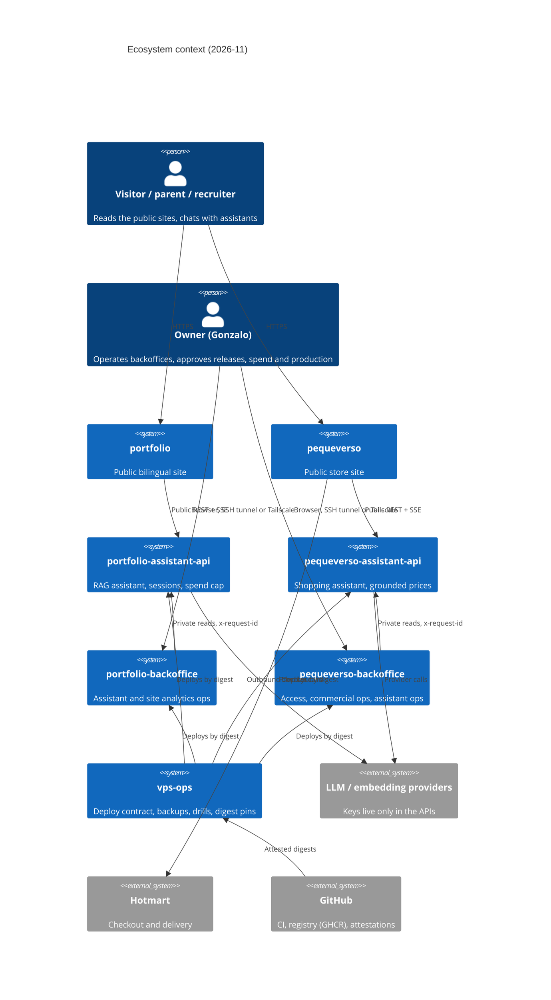

# Ecosystem standard

**Ecosystem standard v1 · 2026-11-09 · canonical copy identical in all nine repositories; edit only through the standards process**

Status: planning standard, not executed. It defines the shared way of working for `portfolio`, `portfolio-assistant-api`, `portfolio-backoffice`, `pequeverso`, `pequeverso-assistant-api`, `pequeverso-backoffice` and `vps-ops`. Each repository's `docs/master-plan/` documents only justified deviations from this file. Nothing here authorizes code changes, deploys, spending or production changes; the owner decides execution per phase. Research notes are cited as `[NN]` = `reports/master-plans-2026-11/research/NN-*.md` (index in section 20). Words MUST, SHOULD, MAY are used in the RFC 2119 sense.

---

## 1. Scope, map, ownership, invariants

### 1.1 The nine repositories

| Repo (local folder) | Type | Runtime and deploy | Visibility (verify) |
|---|---|---|---|
| `portfolio` | Public site (Next.js, bilingual EN/ES, 3D, light and dark) | Hostinger managed Node.js, from `main` | public |
| `portfolio-assistant-api` | Assistant API (FastAPI, LangGraph, pgvector, Neo4j) | Docker on VPS via Coolify | public |
| `portfolio-backoffice` | Backoffice (Next.js, better-auth, Postgres IAM) | Docker on VPS via Coolify | public |
| `pequeverso` | Public store site (Next.js, single light theme by ADR-0006, Hotmart checkout) | Hostinger builds `main` (standalone) | public |
| `pequeverso-assistant-api` | Assistant API (hexagonal, grounded prices) | Docker on VPS via Coolify | public |
| `pequeverso-backoffice` (folder `pequeverso-assistant-backoffice`) | Backoffice (better-auth, Postgres IAM, OTel) | Docker on VPS via Coolify | public |
| `vps-ops` | Ops CLI (Python, Clean Architecture) and deploy contract | Runs locally and on the VPS; pins image digests | private |

Visibility drives tool availability (CodeQL, attestations, harden-runner, Scorecard); the column is an assumption to confirm per repo.

### 1.2 C4 context



### 1.3 Ownership

| Concern | Owner repo |
|---|---|
| Public REST/SSE contract, session cookie, spend budget, provider keys | the matching assistant API |
| Visitor UI, assistant client, product-interaction events (emit) | the matching public site |
| Private reads UI, IAM, operational dashboards | the matching backoffice |
| Image digests, health contract checks, backups, host hardening, `releases/production.lock` | `vps-ops` |
| Shared standards, reusable workflows, rulesets, templates (proposed) | `engineering-standards` (E1) |

### 1.4 Invariants (never relaxed without an ADR in every affected repo)

1. No runtime import or package dependency crosses repository boundaries. Contracts cross as versioned snapshots (OpenAPI, JSON Schema) with revision and SHA-256; code is never imported.
2. Sessions are API-owned, host-scoped cookies; the backoffice never receives a visitor transcript and is not a public chat frontend.
3. No provider key (LLM, embedding, analytics write key) is present in a site, a browser bundle or a backoffice build.
4. Prices, SKUs and claims in the shopping assistant come only from tool results (grounding in code); never from model memory.
5. "Unavailable, never zero": a missing metric is shown as unavailable, never as 0.
6. Pequeverso bio keeps a single link (pequeverso.com), no parameters; tracking by origin is a future improvement.
7. Secrets live in gitignored `.env.local`, environment-scoped CI secrets or SOPS; never in git, images, logs or build args.
8. Everything that needs the VPS (deploy, real observability, online evals, real load) is Phase V and starts only after the owner buys the VPS and authorizes spend.

---

## 2. Owner requirements and decisions log (2026-11-09)

### 2.1 Requirements (binding, verbatim intent from `owner-decisions.md`)

1. Nine master plans, one per repo (seven originally; `pequeverso-marketing` and `dropshipping-ops` added the same day), polished to the maximum, grounded in deep 2025-2026 research.
2. "Perpetual excellence": quality does not degrade over time (ratchets, automatic scorecard, cadences).
3. Consistent READMEs across the nine repos.
4. Assistants: a golden set of RAG questions, 100% correct as release gate.
5. Complete testing: unit, integration, mutation, E2E, contract, visual, a11y, performance, security, load, property-based.
6. Agentic harness (skills, reviewers, evals) good enough that the owner does not need to review code.
7. Use the available skills and harness.
8. First-class, consistent containers: LTS versions, same base configuration, same practices.
9. CI at the maximum: dynamic (runs only what is affected), secure, fast.
10. Dependabot identical in all nine: exactly one PR per week per repo (section 5).
11. Maximum redesign of both backoffices (designer quality, unique UI/UX, shared view/IA standard, per-project identity).
12. Master UI/UX on both public sites (keep identity, polish and elevate, strict performance and accessibility budgets; Pequeverso prioritizes conversion).

### 2.2 Decisions

| # | Decision (date 2026-11-09) | Consequence | Source |
|---|---|---|---|
| O1 | Weekly single Dependabot PR; security-update PRs disabled, alerts on, daily job notifies; a critical vulnerability may wait for the weekly PR | Section 5 | `shared/dependabot-rule.md`, [05] |
| O2 | Pragmatism: ONE golden set per assistant (40-80 items), 100% gate; existing corpora (288 and 330 cases) distilled, rest archived; no hundreds-of-cases suites or parallel datasets | Section 12 | `owner-decisions.md`, [03] |
| O3 | Rigor where it reduces real risk; no ceremony | All sections; "ceremony" flagged explicitly | `owner-decisions.md` |
| O4 | Tailwind 4 + owned CVA primitives in all four web apps; the portfolio backoffice moves off CSS Modules | Section 13; replaces the research suggestion of Base UI/shadcn as dependency | owner; [06], [01] |
| O5 | Keep Coolify as the deploy control plane, with a private dashboard (SSH tunnel or Tailscale only), 2FA, pinned version, independent backups, monthly restore drill. Recorded alternative: Docker Compose + Caddy deployed by digest from the `vps-ops` CLI | Section 2.3 | owner; [09] |
| O6 | Host OS: Ubuntu 26.04 LTS | Section 2.3 | owner |
| O7 | `main` receives releases only (develop to main on demand); hotfix directly to `main` only with explicit owner OK; never `--admin`; merge only with green CI | Section 3 | owner memory rules |
| O8 | Manual owner merge of the weekly dependency PR; promotion to main on demand | Sections 3, 5 | `owner-decisions.md` |
| O9 | Repo documentation is English; public copy is neutral LATAM Spanish with "tú" for Pequeverso, signed "Equipo de Pequeverso" | Section 14 | owner; [08] |
| O10 | Identity: only `gonzalomartinperez` in commits and `gh`; never the secondary account | Agents and CI | owner memory |
| O11 | pequeverso.com publishes on merge to `main` through Hostinger (standalone build); verify `build-info.json` against the merge SHA | Sections 3, 6 | owner memory |

### 2.3 Host and control plane (O5, O6)

[09] recommends against any web-UI control plane on the data host: 70 Coolify advisories by 2026-11-09 (21 critical), many "authenticated user becomes host root" and one API-token flaw (tokens that never expire). The owner keeps Coolify; these compensating controls are therefore mandatory in `vps-ops`:

| Control | Requirement |
|---|---|
| Dashboard exposure | Not published on the internet. Reachable only over SSH tunnel or Tailscale; ports 8000/6001/6002 bound to localhost or tailnet; external `nmap` check scheduled |
| Identity | 2FA on every dashboard account; one human account; API tokens scoped (deploy only), short-lived where possible, rotated quarterly and after any Coolify advisory |
| Version | Pinned Coolify version; upgrade only through a reviewed `vps-ops` change; security advisories watched weekly; critical advisory: patch within 72 h or stop the dashboard |
| Blast radius | Coolify holds SSH keys and every secret: treat it as root. No other service shares its credentials; Postgres and Neo4j never publish ports; provider network firewall as outer layer (Docker-published ports bypass UFW) |
| Backups | Independent of Coolify (WAL-G or pgBackRest for Postgres, offline dump for Neo4j, restic for files, Coolify's own configuration backed up separately). Coolify's scheduled backups are not the only line |
| Drill | Monthly restore drill (Postgres PITR, Neo4j dump, Coolify config); fresh-VPS rebuild drill twice a year; "last tested" date in every runbook |
| Deploy | Image deployed by digest (Coolify accepts a digest; the need to update the digest field via API before the webhook is an inference, validated in staging, [05]) |
| Exit | Alternative recorded as ADR: Compose + Caddy, host converged with Ansible or pyinfra, deployed by the `vps-ops` CLI from `releases/production.lock` ([09] sections 2.4, 11). Trigger to switch: any unpatched critical Coolify advisory older than 7 days, or a failed restore drill |

Host baseline (Ubuntu 26.04 LTS): key-only SSH, `AllowUsers deploy`, no root login, admin SSH over Tailscale/allowlist, `unattended-upgrades` security-only with a reboot window and `needrestart` not restarting databases blindly, fail2ban for sshd, Docker pinned via apt repo, quarterly docker-bench/Lynis audit ([09] section 4).

---

### 2.4 Adopted by default (owner: "if I forgot something, adopt it")

Items the owner did not list but that an end-to-end refactor to excellence needs. Each plan maps them to its repo or marks them not applicable with a reason.

| Area | Adopted items |
|---|---|
| Security surface | CSP with nonces/hashes and HSTS on every web app; `security.txt` (RFC 9116) on public domains; rate limiting on public endpoints; security headers snapshot tests; threat model per auth surface (STRIDE-lite) |
| Privacy and legal | Privacy policy, cookie/consent policy and terms reviewed against Argentina, Mexico and Chile rules; data inventory and retention schedule; no PII in logs; accessibility statement page on public sites |
| Domains and email | DNS records documented; SPF, DKIM and DMARC for sending domains; TLS and certificate expiry monitoring; redirects and canonical hosts verified |
| Reliability | Error tracking (self-hosted or free tier) for APIs and backoffices; uptime probes for public sites and APIs; SLOs and alert routing; incident runbook and post-incident template |
| Cost | Monthly cost ledger (hosting, VPS, LLM spend, domains) with budgets and alerts; LLM spend caps enforced in code |
| Release hygiene | Semantic versions and GitHub releases per repo; stale branch and worktree cleanup; issue labels and templates standardized; repository settings (merge methods, auto-delete head branches, secret scanning, push protection) applied by script |
| Internationalization | Locale-aware formatting (dates, currency, numbers) via `Intl`; translation completeness checks where bilingual; `lang` attributes correct |
| Content integrity | Commercial facts (prices, guarantees, links) single-sourced in config with tests; affiliate disclosures where applicable |
| Developer experience | One-command setup (`just setup` or `npm run setup`), devcontainer for each repo, `check` command mirroring CI locally, fast feedback (< 60 s for the inner loop) |
| Knowledge | GLOSSARY.md per product domain; architecture diagrams kept in sync by a check; onboarding page in each README |
| Data protection | Backups with restore drills for every database; encryption at rest where offered; secrets rotation schedule |
| Analytics | Privacy-respecting, consent-aware analytics with a documented event taxonomy shared across site, API and backoffice |

## 3. Branching and release

### 3.1 Flow

Repository flow classes (owner decisions 2026-11-09): **release repos** (portfolio, portfolio-assistant-api, portfolio-backoffice, pequeverso, pequeverso-assistant-api, pequeverso-backoffice) use task branch → `develop` → `main` by release; **main-only repos** (`vps-ops`, `pequeverso-marketing`, `dropshipping-ops`, all private) use task branch → PR → `main` with the green `ci-gate`, versions as annotated tags on `main`, and enforce the flow without server rulesets through five layers (agent hooks blocking direct pushes, versioned git pre-push hook, merge only on green CI, scheduled commit-provenance audit, full CI).

Refactor mode (owner decision 2026-11-09): during the master refactor every change lands on `develop` through short task branches and the aggregate gate; `main` is promoted once per repo when the whole refactor is finished, as one coordinated release. Production sites (Hostinger autodeploy from `main`) stay unchanged until then.

```
task branch ──PR──> develop ──release PR──> main ──tag──> release
 (Conventional      (aggregate gate        (on demand; merge commit;
  Commits)           ci-gate green)         ci-gate + release checks)
```

| Rule | Standard |
|---|---|
| Branch names | `feat/…`, `fix/…`, `chore/…`, `docs/…`, `deps/…`; short-lived (≤ 5 working days) |
| Merge into `develop` | PR, `ci-gate` green, up-to-date with base (strict), merge commit (rulesets allow merge commits only, matching current repos); the PR title is the Conventional Commit used in the merge message and is checked (`amannn/action-semantic-pull-request`, SHA-pinned) |
| Promotion to `main` | PR `develop` to `main`, merge commit, only on demand by the owner; `ci-gate` plus release checks green; `main` must equal tested `develop` |
| Hotfix | Directly to `main` only with explicit owner OK in the conversation; never `--admin`, no bypass actors; immediately back-merged to `develop` |
| Merge command | `gh pr checks --watch && gh pr merge`; never chained with `;` |
| Develop age | Report weekly "develop is N commits ahead of main"; develop-only state older than 7 days is released or reverted ([05] section 6) |
| Back-merge | After each release, an automatic PR `main` to `develop` |
| Rulesets | Applied by script (section 6.5): PR required, `ci-gate` required, strict, no force-push or deletion, no bypass actors; tag ruleset for `v*` (no create/update/delete outside the release workflow) |
| Merge queue | Not adopted (single author; availability for user-namespace repos unverified). Workflows still listen to `merge_group` so it can be enabled later ([05] 2.5, [11] 6.7) |

### 3.2 Versioning and changelog

- Conventional Commits; SemVer; `CHANGELOG.md` in Keep a Changelog sections, generated by **release-please** (manifest mode), with `changelog-sections` mapped to Added/Changed/Fixed/Removed/Security ([05] section 6). Changesets only if a repo becomes a published multi-package library.
- release-please runs against `develop` (proposed): it keeps one release PR that bumps version and changelog; the owner merges it when a release is wanted, then promotes `develop` to `main`. A workflow on `main` creates the tag `vX.Y.Z` from the manifest and an **immutable** GitHub Release (assets: SBOM, provenance). One deploy per release, including for Hostinger autodeploy. Open point E5: validate in a sandbox; fallback is release-please on `main`.
- release-please needs a GitHub App token or fine-grained PAT (the `GITHUB_TOKEN` does not trigger CI on its PRs); prefer an App, stored in an environment-scoped secret.
- Images carry the tag `vX.Y.Z` for humans; the deployed reference is always `@sha256:<digest>`.

### 3.3 Coordinated multi-repo releases

Repos version independently and coordinate through contracts, not lockstep tags ([05] section 6). Procedure in section 18.2. Contract changes follow expand/contract: the producer ships a backward-compatible version first, consumers refresh snapshots and release, removal happens only after every consumer moved, and a removal is a major version with ADR and `contract-major` label.

---

## 3A. Milestones and safe points (owner request 2026-11-09)

The refactor advances through ecosystem-wide milestones. Each milestone is a **safe point**: work can stop there for days and resume without archaeology.

A milestone is reached only when, in every repo it touches:

1. `develop` is green on the full `release` CI profile (not just the PR profile), with no open refactor PRs left half-done (merged or closed with a note).
2. The repo's `docs/master-plan/progress.md` is updated: milestone ID, date, develop SHA, scorecard snapshot, what changed, what is next, known issues, and decisions still pending.
3. An annotated git tag `checkpoint/M<n>` is pushed on `develop` (not a release; `main` is untouched until M7).
4. The ecosystem tracker (`engineering-standards/progress/ecosystem.md`, or `vps-ops` until that repo exists) records the milestone row for all nine repos and the exact command or prompt to resume.

Session independence (owner requirement 2026-11-09): the refactor must be continuable from any Claude account, machine or agent with no access to this or any previous chat. Everything needed lives in git:

- `docs/master-plan/RESUME.md` in every repo: a self-contained brief (what the refactor is, current milestone, where the standard and plan files are, the exact first command and the exact prompt to paste into a new session, owner-only decisions, rules that must never be broken).
- `docs/master-plan/progress.md` in every repo, plus the nine-row ecosystem table copied in each (updated only at milestones; a drift check compares the copies).
- `docs/master-plan/research/` in every repo holds the research notes the plan relies on, so no decision depends on a local folder.
- Owner decisions are recorded in `ecosystem.md` section 2 and in each plan's README, never only in chat.

Resume rule: a new session reads `RESUME.md` of any repo, then the ecosystem tracker, then each repo's `progress.md`, checks out `develop` at or after the `checkpoint/M<n>` tag, and continues with the first unchecked item of the next milestone. Nothing is resumed from memory or chat history.

| Milestone | Name | Scope (all nine repos unless stated) | Exit criteria (safe point) |
|---|---|---|---|
| M0 | Plans merged | Nine master plans + ecosystem standard merged by docs-only PRs (to `develop` in release repos, to `main` in main-only repos) | Plans merged in all nine repos; owner decisions list delivered |
| M1 | Foundation | `engineering-standards` repo; shared reusable workflows; CI profiles and `ci-gate`; rulesets script; Dependabot weekly rule proven in a sandbox and rolled out; daily vulnerability job; containers on the LTS matrix with the canonical Dockerfile; harness (skills layout, review chain, activation evals skeleton) | Every repo on shared CI v1 green; one weekly Dependabot PR per repo observed or simulated; image builds reproducible with SBOM + provenance (VPS repos) |
| M2 | Quality net | Full test catalog wired per repo (unit, integration, contract, E2E incl. WebKit iPhone, visual baselines, axe, Lighthouse/perf budgets, property, security, data); coverage + diff coverage gates; mutation incremental on PRs + nightly full; golden sets v1 with deterministic graders (APIs); scorecard tooling and ratchet baselines committed | `scorecard.json` produced nightly in every repo; no gate in warn mode older than 14 days; golden set 100% in cassette replay |
| M3 | Phase A polish | All P0/P1 audit findings fixed (performance, accessibility, CRO trust/consent issues, docs/README template, community files); first independent re-score | P0/P1 closed with evidence; re-score recorded; no regressions vs M2 ratchets |
| M4 | Architecture and TypeScript | Target architecture per repo with guards in enforce mode (empty baseline); every remaining .js/.mjs/.cjs migrated or justified; mypy strict 0 errors; contract changes done expand→contract across repos | Guards enforce with empty baseline; 0 type errors; contract cross-jobs green |
| M5 | Master design | Shared token architecture; portfolio "Instrument blue" palette + light/dark parity; hero particle system v2 with 10 figures; Pequeverso conversion page + elevated identity; both backoffices redesigned on the shared view standard with unique identities | Visual baselines approved in both themes; designer/CRO/recruiter evaluator ≥ 95 or a documented gap list; fluidity and performance budgets green |
| M6 | Excellence verified | Copy refresh: all public copy (portfolio EN/ES incl. case studies, CV-linked facts and project descriptions; pequeverso store, legal and support pages; READMEs and repo descriptions) rewritten to match the final post-refactor reality, using only verified facts (career-ops for the portfolio, config for Pequeverso), Spanish rules for Pequeverso, independent recruiter/CRO evaluation; remaining gaps closed; mutation thresholds at target; documentation and skills finalized; independent three-lens re-score of every repo | Every axis ≥ 95 (or ≥ 90 where blocked by VPS/spend/labels, documented) on two consecutive nightly scorecards |
| M7 | Release to main | One coordinated release per repo (`develop → main`), in contract-safe order (APIs, backoffices, sites, vps-ops pins), post-deploy verification for Hostinger sites | `main` = released `develop`; post-deploy checks green; CHANGELOGs and tags `vX.Y.Z` published |
| M8 | Profile showcase | After every repo is at M7: redesign the GitHub profile (`gonzalomartinperez/gonzalomartinperez` README) to an outstanding, designer-grade presentation: hero with light/dark assets, positioning as AI Engineer from career-ops facts, featured projects with measured results and links to public repos, architecture and quality highlights (scorecards, evals, CI), animated SVG elements within GitHub limits, consistent visual identity with the portfolio (Instrument blue), pinned repos, repo descriptions/topics/social previews for all public repos, English with optional Spanish section; independent recruiter-lens evaluation ≥ 95 | Profile README merged; all public repos have description, topics, homepage and social preview; recruiter evaluator ≥ 95; facts match career-ops |
| MV-R | VPS readiness (part of M6 exit, owner requirement 2026-11-09) | Everything VPS-bound is ready before the VPS exists: release-candidate images for both APIs, both backoffices, Postgres and Neo4j built by the release profile with SBOM + provenance and verified digests (kept as CI artifacts or in a private registry namespace without deploying); vps-ops registry v2 filled for both projects; Coolify configuration as code; secrets inventory (names only) and SOPS templates; backups, monitoring and alerting configured; a full-stack rehearsal on a disposable Ubuntu 26.04 VM with Coolify running the exact candidates (health, SSE through the proxy, migrations, restore drill, rollback); `day-one.md` runbook | Rehearsal green end to end; day-one runbook executable in ≤ 2 hours of agent work after purchase with only owner steps being purchase, DNS and secret entry |
| MV | VPS activation (gated) | Buy and provision VPS (Ubuntu 26.04 LTS, Coolify hardened), deploy APIs/backoffices by digest, observability, backups + restore drill, live golden runs under spend cap, assistant activation on sites | Owner authorization; restore drill passed; SLO dashboards live; assistants pass live golden set at 100% |

Within a milestone, each repo has its own ordered checklist in `roadmap.md`; repos may finish a milestone at different times, but the ecosystem milestone is reached only when all of them have. Stopping mid-milestone is allowed; the safe point to fall back to is always the last `checkpoint/M<n>` tag.

## 4. Branch and merge hygiene by the agent harness

The harness (section 15) opens PRs only from task branches, never pushes to `develop` or `main`, never merges the weekly dependency PR, and never promotes to `main`. Every PR template carries: summary, linked issue, evidence (CI run, report), docs/changelog touched, agent-docs touched, risk.

---

## 5. Dependabot: weekly single PR rule (identical in all nine repos)

Source: `shared/dependabot-rule.md`, [05], [10].

### 5.1 Rule

Exactly one dependency PR per repo per week containing every dependency of every ecosystem (npm or uv, GitHub Actions, Docker). Monday 09:00 America/Argentina/Buenos_Aires (UTC-3 fixed). Target `develop`. CI green before the owner merges manually. If last week's PR is still open, no second PR appears: it is updated (rebased on `develop` plus the newer versions of both weeks) or replaced by a single PR that supersedes it. Never two dependency PRs open at once.

### 5.2 Mechanism

| Element | Setting |
|---|---|
| Config | `.github/dependabot.yml` with `multi-ecosystem-groups` (GA 2025-07-01), group `weekly` carrying `schedule` (weekly, Monday, `09:00`, `America/Argentina/Buenos_Aires`) and `target-branch: develop`; every `updates` entry (`npm` or `uv`, `github-actions`, `docker`, `docker-compose` where present) joins with `multi-ecosystem-group: weekly` and `patterns: ["*"]` |
| Open PR limit | `open-pull-requests-limit: 1` per ecosystem entry; the group yields one PR |
| Cooldown | `default-days: 7`, `semver-major-days: 14`, `semver-patch-days: 3` (applies to version updates only; wildcard-group interaction unverified, [05] S38) |
| Security updates | Disabled in repository settings (Advanced Security, Dependabot security updates); Dependabot alerts remain on |
| Standard | `dependabot.yml` is copied from `engineering-standards` and verified by the drift check |
| Hostinger sites | Cooldown stays at the long values: a bad dependency ships straight to production ([05] section 8) |

### 5.3 Guard (`deps-weekly-guard`, shared workflow)

Runs Monday 10:30 ART and on Dependabot PR events. Asserts at most one open Dependabot PR; if two, closes the older with a comment pointing to the newer; ensures the survivor is current with `develop` (`@dependabot rebase`, or `recreate` when superseded, because pushing a manual fix to a Dependabot branch disables its rebases); if CI is red, opens or updates a tracking issue and labels the PR `needs-fix` so the harness repairs it on the same branch. It also fails if any pinned base-image digest is older than 30 days ([11] recommendation 10).

### 5.4 Unverified until Phase A on a sandbox repo (rollout blocked until proven)

(1) An open grouped PR is updated instead of a new PR opening. (2) Day, time and timezone are honoured on groups. (3) `uv` and `github-actions` are accepted in a multi-ecosystem group. (4) Cooldown applies inside groups. If (1) fails, the guard performs the supersede flow (close old, one new). The result is recorded in an ADR.

### 5.5 Daily vulnerability job and SLA

No PR is opened by the job; it notifies (issue labelled `vuln`, owner mention) and records the finding.

| Job | Tool | Cadence |
|---|---|---|
| Dependency advisories | osv-scanner (full, scheduled) plus Dependabot alerts | daily |
| Deployed digests | Grype or osv on the digests in `releases/production.lock` (advisory DB changes though the image does not) | weekly (daily once Phase V) |
| Compromise watch | check of workflows against known-compromised actions list | daily |

| Trigger | Target to fix or mitigate |
|---|---|
| In CISA KEV or actively exploited, reachable | 72 h (mitigate: disable, pin, rollback; rotate secrets if CI-adjacent) |
| Critical (CVSS ≥ 9), internet-facing API or backoffice | 7 days; owner accepted that it may ride the weekly PR, but a KEV or reachable critical triggers the manual path below |
| High, fixable | 30 days (base-image High: next rebuild) |
| Medium | 90 days or next weekly PR |
| Low, unreachable, dev-only | Best effort, quarterly review; documented ignore with expiry |
| Compromised action or package incident | Same day: pin or remove, rotate secrets, audit runs in the window |

EPSS above 0.5 or a public exploit escalates one tier. Every exception is an issue with owner, reason and expiry ≤ 90 days; scanner ignore files reference it. Manual path: because security-update PRs are off, an urgent fix is a normal task-branch PR bumping the single dependency, merged by the owner; it does not create a second Dependabot PR. SLA numbers are policy choices, not standards ([05] section 7). Public repos add `SECURITY.md` (acknowledge in 5 days) and private vulnerability reporting.

---

## 6. CI standard

### 6.0 CI profiles by PR type (owner request 2026-11-09: standardize and optimize to the maximum)

One `ci.yml` entry point per repo calls the shared reusable workflows from `engineering-standards`. A `classify` job (first, ≤ 30 s) reads the changed files, the branch name and the PR labels, and emits a profile; every downstream job is conditional on it, and the single required `ci-gate` job fails closed (any failed or cancelled needed job fails it; skipped jobs pass only when the profile says they are not applicable).

| Profile | Trigger | Runs | Skips | Budget p50 |
|---|---|---|---|---|
| `docs` | only `**/*.md`, `docs/**`, ADRs, images under docs | markdownlint, lychee links, Vale (optional), docs/skills checks, secret scan | build, tests, images | ≤ 2 min |
| `deps-weekly` | Dependabot weekly group branch | full profile + dependency review, licence check, SBOM diff, lockfile lint, image rebuild and scan if Docker/base changed | nothing | ≤ full budget + 3 min |
| `code` (default) | any source change | lint, types, unit, architecture guard, affected integration/contract/E2E shards, build once, budgets, incremental mutation on changed files, visual on affected routes | unaffected suites (path map per repo) | per repo type (section 6.2) |
| `contract` | `contracts/**` or OpenAPI/SSE schemas changed | code profile + oasdiff breaking check, schemathesis, cross-repo consumer compile job; `contract-major` label required for breaking | — | code + 2 min |
| `assistant-quality` | prompts, retrieval, golden set or grader changed (API repos) | code profile + golden set in cassette replay (100% gate); live golden run is a manual dispatch under the spend cap | live run by default | code + 3 min |
| `workflow` | `.github/**` changed | actionlint, zizmor (high), pinned-SHA policy, dry-run of changed reusable workflow on the PR | — | ≤ 3 min |
| `release` | `develop → main` promotion PR | full matrix on every engine, full mutation (or last nightly ≤ 24 h green), Lighthouse, visual all routes, image build + SBOM + provenance + verify, changelog check | nothing | ≤ 2 × code budget |
| `hotfix` | `hotfix/*` → `main` with owner authorization label | code profile + release verification for touched surfaces; auto back-merge PR to develop afterwards | — | code budget |

Nightly (`nightly.yml`): full mutation, flake detector (`--repeat-each`), full cross-browser matrix, Scorecard, osv/grype on published digests, scorecard.json re-score and ratchet check. Weekly: `deps-weekly-guard`, link check of all docs, standards drift check (every repo's `ecosystem.md` and shared workflow pins match the current standards tag).

Optimizations common to all profiles: concurrency group per ref with cancel-in-progress for PRs; dependency caches keyed on lockfiles; Next.js build cache; Playwright browsers cached per version; Docker buildx with GHA cache; artifacts passed between jobs (build once); shard counts sized from measured durations; job timeouts on every job; `paths` maps live in one `ci-profile.json` per repo validated by a unit test so no file can fall outside every profile.

### 6.1 Graph

```
plan (affected detection) ─┬─> static (lint, types, arch guard) ─┐
                           ├─> test shards (unit, integration) ──┼─> build ONCE ─> e2e | image scan | attest ─> ci-gate
                           └─> security (zizmor, osv, gitleaks, codeql where available)
```

| Rule | Standard | Source |
|---|---|---|
| One required check | `ci-gate`: `if: always()`, `needs: [all jobs]`, passes only if every result is `success` or `skipped`; fails on `failure` or `cancelled`. Rulesets require only this name | [05] 2.1, [11] 6.2 |
| Affected-only | A `plan` job computes booleans from `git diff --name-only BASE HEAD` (15-line script from `engineering-standards`, no third-party action; handles `merge_group`; on error outputs ALL). Job-level `if:`, never workflow-level `paths:` on workflows that supply required checks | [11] 6.1 |
| Fail-closed | Unknown change class, diff error, or a changed file outside every filter runs everything. Docs-only runs lint, links and the gate | [11] |
| Dynamic matrices | `plan` emits JSON for `strategy.matrix`; `fail-fast: false` | [11] 6.3 |
| Build once | One build job produces the artifact (`.next` standalone or image by digest); e2e, scan, attest consume that exact artifact; never rebuild at deploy | [05] 2.2 |
| Caching | Package-manager stores keyed on lockfile (not `node_modules`); `.next/cache` keyed on lockfile + source hash; Docker `cache-to type=registry,mode=max` on GHCR `:buildcache` (distinct per image) for multi-image repos, `type=gha` allowed for small ones; only the default branch writes broad caches | [05] 2.3, [11] 6.4 |
| Sharding | Only when a job exceeds budget. Playwright `--shard`, `fullyParallel`, blob reports merged in a final job (`if: !cancelled()`); shards = ceil(minutes/4), max 4-6 | [04] 7 |
| Concurrency | `group: ci-${{ github.workflow }}-${{ github.ref }}`, cancel in progress for PRs only; never for release or deploy | [11] 6.7 |
| Timeouts | Every job sets `timeout-minutes` (lint/unit 10-15, e2e 25, image 30, gate 2) | [11] |
| Playwright fast path | `--only-changed` as a PR accelerator only; full run on release and nightly (source-to-test mapping unconfirmed) | [11] 6.3 |

### 6.2 Duration budgets (alert when p95 drifts above 25% of the 4-week baseline)

| Repo type | PR critical path p50 / p95 | Nightly | Release |
|---|---|---|---|
| Public site | 5 min / 10 min (lint + types ≤ 2, image/build warm ≤ 4) | ≤ 45 min | ≤ 30 min |
| Backoffice | 6 min / 12 min | ≤ 45 min | ≤ 30 min |
| Assistant API (cassette lane, no network) | 5 min / 10 min | ≤ 60 min (live eval lane under spend cap) | ≤ 45 min |
| vps-ops | 3 min / 6 min | ≤ 20 min | ≤ 15 min |

Over budget: fix cache hit rate, then split jobs, then shard, last paid runners. A weekly workflow prints p50/p95 of the last 30 runs (`gh run list --json`).

### 6.3 Flake policy

No blanket retries on unit tests. Playwright `retries: 1` on CI only; a test passing on retry is recorded as flaky, not green; `failOnFlakyTests` on `main` and release, warning on PRs for the first month. A flaky test gets an issue labelled `flaky` and is quarantined the same day (tagged, run in a non-blocking job, listed in a repo file); fix or delete within 7 days; quarantine cap 2% of tests or 5, whichever is smaller. First-attempt failure rate on `main` above 2% over 20 runs stops feature work. Required checks must show 0 flaky tests over 30 days (rubric D3). Sources: [04] 7, [05] 2.6.

### 6.4 Workflow hardening (all repos, enforced by zizmor in CI)

| Control | Rule |
|---|---|
| Token | `permissions: {}` at workflow top; grants per job; `id-token`, `attestations`, `packages` write only on the build/attest job |
| Actions | Every `uses:` pinned to a full commit SHA with a version comment; repository policy "require full-SHA pinning" on; Dependabot bumps hash and comment; local reusable workflows from the standards repo pinned by SHA too |
| Checkout | `persist-credentials: false` unless the job pushes |
| Triggers | No `pull_request_target` or `workflow_run` that checks out PR head; no `${{ }}` of untrusted context inside `run:` (pass through `env:`) |
| Scanners | zizmor (regular persona, online audits with token) and actionlint on any PR touching `.github/**`; gitleaks; secret scanning and push protection on |
| Egress | `step-security/harden-runner` audit then block with allowlist on public repos and on publish/deploy jobs only; free tier is public-only, vendor product, native GitHub egress firewall is roadmap ([05] 3.15, [11] 6.6) |
| Environments | `production` environment with required reviewer (owner) and branch restriction; Coolify token with deploy-only scope lives only there |
| Roadmap features | Workflow dependency locking, native egress firewall: watch, do not depend ([05] 1.3) |
| Third-party actions that see secrets | A trust decision recorded in an ADR; `tj-actions/*` and `aquasecurity/trivy-action` older than the safe release are banned |

### 6.5 Central standards repository

Proposed name `engineering-standards` (owner decision E1), owned by `gonzalomartinperez`, with branch and tag protection, CODEOWNERS on `.github/workflows`, signed tags, and a canary repo for every change (single point of compromise for seven repos, [11] 6.5).

| Content | Purpose |
|---|---|
| `.github/workflows/` reusable: `ci-node.yml`, `ci-python.yml`, `docker-build.yml`, `security.yml`, `attest-image.yml`, `release.yml`, `deps-weekly-guard.yml`, `scorecard.yml`, `drift.yml` | Called by each repo at job level with `uses: gonzalomartinperez/engineering-standards/.github/workflows/x.yml@<SHA> # vX.Y.Z` |
| Composite actions | Step-level reuse: setup-node, setup-uv, plan |
| `rulesets/*.json` + `scripts/apply-rulesets.sh` (idempotent, `gh api`) | A user namespace has no org rulesets, so each repo gets identical rulesets by script; weekly drift-report mode |
| Templates | `dependabot.yml`, `release-please-config.json`, `.gitleaks.toml`, `SECURITY.md`, PR and issue templates, README, ADR, AGENTS.md and SKILL.md skeletons, Dockerfile templates, `.hadolint.yaml`, `docker-bake.hcl` fragments, compose hardening snippet, token package, Biome preset, tsconfig base |
| `standards.lock` | Ecosystem version and the SHA of each reusable workflow |

Consumers pin by SHA; Dependabot bumps the pin in the weekly PR. Private reusable workflows need the "Accessible from repositories" setting; keep the repo private only if that is verified, else public. Attestation identity is the standards workflow path, so `gh attestation verify --signer-workflow gonzalomartinperez/engineering-standards/.github/workflows/attest-image.yml` pins the verifier ([05] 2.7).

---

## 7. Supply chain

| Control | Standard | Applies to | Source |
|---|---|---|---|
| SBOM | CycloneDX JSON via Syft; attached as attestation (`actions/attest`) and release asset; SPDX export only on request | image-producing repos; site CI artifact | [05] 3.9 |
| Provenance | `actions/attest-build-provenance` or `attest` with `subject-digest`, `push-to-registry`; built in the isolated `attest-image.yml` reusable workflow. Claim: Build L2 now, L3 via the isolated workflow, Source about L1-L2; never claim more | 4 Docker repos | [05] 3 "SLSA positioning" |
| Verify before deploy | `gh attestation verify oci://IMAGE@sha256:… --signer-workflow …` in the deploy job and in `vps-ops` before it records a digest | APIs, backoffices | [05] 3.8 |
| Signing | GitHub attestations only; cosign keyless only if a verifier outside GitHub appears | — | [05] 3.11 |
| Image scan | Grype on the built digest, fail on fixable High or Critical; Trivy allowed only as a SHA-pinned binary at or after v0.35.0 (March 2026 compromise: tags of trivy-action and setup-trivy were force-pushed, images by digest were unaffected) | image repos | [05] 3.10, [11] 5.5 |
| Dependency review | `dependency-review-action` on PRs for public repos; osv-scanner PR mode for private | all | [05] 3.12-13 |
| CodeQL | Default setup with `actions` and JS/TS (Python) where free (public repos). Private-repo availability and price are **unverified**; fall back to zizmor + osv + semgrep-style rules | public repos first | [05] 3.5 |
| Scorecard | Weekly action with SARIF and badge on public repos; fail if score drops more than 1 point; accept the ceiling on Code-Review and Branch-Protection for a solo repo | public repos | [05] 3.16 |
| Secret scanning | GitHub secret scanning and push protection on; gitleaks in CI; secret-serialization audit (`repr`, `model_dump`, logs, spans) | all | [05] 3.4 |
| Releases | Immutable releases switched on before the first release of each repo; tag ruleset for `v*` | all | [05] 3.6 |
| Install-time code | `npm ci --ignore-scripts` with an allow-list for builds; `uv sync --locked` with `exclude-newer = "7 days"`; lockfiles committed and diff-reviewed | all | [10] B2 |
| Private-repo attestations | Six of nine repos are public (`vps-ops`, `pequeverso-marketing`, `dropshipping-ops` are private) (verified 2026-11-09), so attestations, CodeQL, Scorecard and dependency review are free there; the three private repos produce no published images, so the private-repo gap does not block the standard | vps-ops | [05] 3.7 |
| Hostinger sites | Provenance cannot cover Hostinger's build. Compensate: `main` ruleset, tag ruleset, post-deploy check of `build-info.json` against the merge SHA, long cooldown, post-build scan of `out/` or `.next/` for forbidden strings | portfolio, pequeverso | [05] section 8, [01] |

Remember: provenance proves where an artifact was built, not that the workflow was uncompromised (Shai-Hulud 2.0 packages carried valid provenance), so the build workflow stays free of untrusted-input triggers ([05] section 1).

Dependency policy (any new runtime dependency passes an ADR with: need vs platform, health via Scorecard and deps.dev, licence allow-list MIT/Apache-2.0/BSD/ISC/0BSD/BlueOak, bundle cost over 10 kB gz needs justification, maintainer count, exit cost); MADR template in [10] "Dependency policy template".

---

## 8. Containers

### 8.1 LTS matrix (data as of 2026-11-09, [11] section 1)

| Component | Fleet standard | Support ends | Note |
|---|---|---|---|
| Node.js | **26 LTS** (Active LTS since 2026-10-28) after a two-week CI matrix with 24; 24 is Maintenance since 2026-10-20 | 26: 2029-04-30; 24: 2028-04-30 | Never 25 (EOL 2026-06-01). Rule: newest Active LTS; fall back to Maintenance LTS only within 12 months. Next.js and native deps (sharp) on 26 not yet verified |
| Python | **3.14.x** (bugfix to about Oct 2027) | 2030-10-31 | 3.15 non-blocking CI job; adopt around 3.15.3-3.15.4 once wheels exist; no free-threading in production ([02] 12) |
| PostgreSQL | **18.x**, `postgres:18.x-trixie` | 2030-11-14 | One image for both stacks; PG 18 layout: data at `/var/lib/postgresql` |
| pgvector | `pg18` build (apt package or `pgvector/pgvector:pg18-trixie`; choose one for both repos) | no formal EOL | HNSW parallel builds need `--shm-size` ≥ `maintenance_work_mem` |
| Neo4j | **5.26 LTS** (5.26.33-community), digest-pinned | 2028-06-06 | Not the monthly 2026.x line; recheck if a 2026 LTS is announced |
| Debian | **13 trixie** everywhere (python slim-trixie, postgres trixie, node trixie-slim, distroless debian13) | 2030-06-30 | One glibc, one CVE vocabulary |
| Host OS | Ubuntu 26.04 LTS | per Canonical | Owner decision O6 |
| Alpine | not used for Python or Postgres | — | musl wheels and collation differences; Alpine to trixie Postgres move uses `pg_dump`/restore plus `REINDEX`, never a volume swap, with a backup and a drill |

Policy: Node = newest Active LTS; Python = newest minor in bugfix phase where all lockfile deps have wheels; Postgres = newest major at least 6 months old; Neo4j = latest LTS; OS = Debian stable. A quarterly review re-reads endoflife.date and updates this table ([11] section 4).

### 8.2 Canonical Dockerfile rules

| Rule | Python (FastAPI, uv) | Next.js standalone | Postgres + pgvector | Neo4j |
|---|---|---|---|---|
| Base | `python:3.14.x-slim-trixie@sha256` | build `node:26.x-trixie-slim@sha256`; runtime `gcr.io/distroless/nodejs26-debian13:nonroot@sha256` | `postgres:18.x-trixie@sha256` + pgvector | `neo4j:5.26.x-community@sha256` |
| Build | Multi-stage; uv pinned by version and digest; `UV_PYTHON_DOWNLOADS=0`, `UV_COMPILE_BYTECODE=1`, `UV_LINK_MODE=copy`; `uv sync --locked --no-editable`; cache mounts; copy only `.venv` | `npm ci --ignore-scripts` with cache mount; `output: 'standalone'`; copy `.next/static` and `public` | No custom code beyond the apt install | No Dockerfile unless a plugin is needed |
| User | UID/GID 65532, no shell, no home | distroless `nonroot` (65532) | image default after init | image default |
| FS | `PYTHONDONTWRITEBYTECODE=1`; read-only root works with `tmpfs /tmp` | read-only root works | writable data volume; tmpfs for `/var/run/postgresql` | writable `/data`, `/logs` |
| Health | stdlib `urllib` call to `/healthz` (no curl in slim) | `node -e fetch(...)` against `/api/health` (no shell) | `pg_isready` | cypher-shell or HTTP probe |
| Reproducibility | `SOURCE_DATE_EPOCH` from `git log -1 --pretty=%ct`; pinned digests; `uv lock --check` in CI | same | — | — |
| Secrets | Only `--mount=type=secret`; never `ARG`/`ENV` (provenance `mode=max` embeds build args and the Dockerfile) | same | env from secret store | `NEO4J_AUTH` from secret |

Shared rules: no `latest`; every `FROM`/`image:` is `name:<full-version>-<variant>@sha256:…` (tag for humans, digest deploys); no baked tini, use runtime `init: true` if Coolify honours it (unverified); amd64 only unless the VPS is arm64; `.dockerignore` mandatory; BuildKit via `docker-bake.hcl` as single entry point locally and in CI; templates live in `engineering-standards` and drift is checked. Docker Hardened Images: pilot behind a build ARG on one API and one backoffice for 30 days (Dependabot digest bumps and Coolify pull from `dhi.io` to prove); not a prerequisite ([11] section 2).

### 8.3 Runtime hardening (Coolify custom Docker options or compose)

`read_only: true`, `tmpfs: /tmp`, `cap_drop: [ALL]`, `security_opt: [no-new-privileges:true]`, non-root `user`, `pids_limit`, `mem_limit` (with `memswap_limit` equal), `cpus`, `restart: unless-stopped`, `stop_grace_period` matching drain time. Postgres and Neo4j start from `cap_drop: ALL` plus `CHOWN, SETUID, SETGID, DAC_OVERRIDE, FOWNER`, validated empirically before enforcing. Publish nothing except the proxy's 80/443; databases bind to private networks only. Coolify honours only the documented custom options and ignores the rest with a warning ([11] 5.6).

### 8.4 Image naming, labels, tooling

- Name: `ghcr.io/gonzalomartinperez/<repo>` (one image per deployable; backoffices and APIs distinct); tags `vX.Y.Z` and `sha-<short>` only.
- OCI labels on every image: `org.opencontainers.image.{title,source,version,revision,created,licenses}` plus `description` and `documentation`; `licenses` is `UNLICENSED` for private repos.
- Gates in CI: hadolint, dockle (CIS-DI), container-structure-test (USER, labels, entrypoint, no shell on distroless), Grype, then attest. Dev containers use the same `PYTHON_IMAGE`/`NODE_IMAGE` ARGs and the production Postgres image ([11] 5.7).

### 8.5 Health endpoints contract (all services)

| Endpoint | Meaning | Rules |
|---|---|---|
| `GET /healthz` (Next.js: `/api/health`) | Liveness; no dependencies | 200 with `{status, version}`; no auth |
| `GET /readyz` | Readiness; checks Postgres, Neo4j, migration state | 200 or 503; body includes `version` (git SHA) and `schema_version`; no secrets or PII |
| Shutdown | SIGTERM handled, in-flight requests drained, SSE streams closed cleanly, spend reservations released | `stop_grace_period` set |
| Env schema | Published file listing variable names, required, secret or not | `vps-ops` validates before deploy |
| Migrations | Expand/contract, backward-compatible for one release; run as an explicit pre-deploy job gated by a fresh backup marker, never at container start | [09] section 11 |

---

## 9. Architecture standard

Pragmatic Clean Architecture: the dependency rule is mandatory everywhere and enforced by a guard with negative fixtures and an empty violation baseline (rubric D1); the number of layers depends on repo type. Where a layer would only forward calls, it is ceremony and is omitted (O3).

| Repo type | Structure | Layering that earns its keep | Ceremony to avoid |
|---|---|---|---|
| Public site (portfolio, pequeverso) | `app/` + `features/` + `shared/` + `content/`; typed `content/` module for copy, pricing and checkout out-links; one `hotmart.ts` URL builder with unit tests (pequeverso) | `server-only` markers; no `process.env` outside `env.ts`; no data-client imports in `app/**`; features cannot import adapters | Ports/adapters, use-case classes, DAL for static content ([01] 1.2, section 8) |
| Backoffice | `server/{container,env,dal,domain,adapters}`; `domain/` holds IAM rules as pure functions; every Server Action: validate, `requireSession()`, `authorize(permission, resource)`, use case, revalidate | Composition root in `container`; DAL enforces authz (`proxy.ts` only for optimistic redirects); test that every `"use server"` export calls an auth function; `use cache` only for tenant-agnostic reads | Repository interfaces for one adapter; DI frameworks |
| Assistant API | `domain` / `application` (use cases, LangGraph graph) / `ports` / `adapters` (pgvector, Neo4j, LLM) / `api`; composition root in the lifespan; frozen `BaseSettings` with `SecretStr`, `extra="forbid"`; no DI framework | import-linter contracts (`layers`, `forbidden` external packages in domain, `independence` between adapters) plus the AST guard only for rules import-linter cannot express (banned calls such as `datetime.now()`, `os.environ` outside platform); closed SSE event set; disconnect cancels the graph and releases spend | Splitting a use case per function; generic repository wrappers |
| Ops CLI (`vps-ops`) | `cli` to `services` to `adapters` (ssh, docker, systemd) to `domain`; ports for `Shell`, `Clock`, `Filesystem`; `--dry-run` default for destructive commands | import-linter; fakes in tests | Facades kept "temporarily"; per-command abstractions |

Guard tooling by stack: TS repos use an architecture test (`node:test` or Vitest) plus Biome `noRestrictedImports`, `noPrivateImports`, `noImportCycles`, `noUndeclaredDependencies` and `knip` in CI; Python repos use import-linter plus `vulture`-class dead-code checks. Guards run in pre-commit, `just check` or `npm run check`, and CI. Guard rules have negative fixtures (a deliberately illegal import must fail).

TS-only extras: `typedRoutes`, Node subpath `imports` instead of `paths`, explicit `types`, pin Next.js to the current supported line and subscribe to monthly security releases (out-of-band releases occurred on 2026-09-22 and 2026-10-14, [01] section 8). Verify the pequeverso deploy mode (static export vs standalone) first: it decides whether headers, redirects and Server Actions exist ([01] section 8).

---

## 10. Code standards

### 10.1 TypeScript (all four web repos and scripts)

| Topic | Standard |
|---|---|
| Style | Google TypeScript Style Guide for semantics; Biome formatter for layout (2-space, 100 columns, double quotes, semicolons) |
| Deviations | No `enum` (unions or `as const`), no `namespace`, no parameter properties, no decorators, no `import =` (erasable syntax); default exports only for framework entry files and `*.config.ts`; `undefined` internally, `null` only at I/O boundaries; `type` for unions and mapped types, `interface` for extendable object shapes; `#private` allowed in new code; camelCase for `as const` objects, CONSTANT_CASE for primitive module constants |
| Compiler | TypeScript 7 as `tsc` (separate CI job, hard gate); `strict`, `noUncheckedIndexedAccess`, `exactOptionalPropertyTypes` (per-repo opt-out with a comment), `verbatimModuleSyntax`, `erasableSyntaxOnly`, `noImplicitOverride`; TS 6 alias only for tools needing the programmatic API (none until 7.1) |
| Lint | Biome 2.x pinned exactly; domains `next`, `react`, `test`, `project`; no typescript-eslint unless a plugin is indispensable; optional CI-only `oxlint --type-aware` |
| File naming | `kebab-case` for every file and folder (`user-menu.tsx`); `PascalCase` only for exported components, types and classes; framework-mandated names (`page.tsx`, `route.ts`) as is; tests `*.test.ts(x)` next to the unit; no barrel files except a package public API |
| Scripts and configs | `.mts`/`.ts` run by Node type stripping (Node ≥ 24.12); `.js/.mjs/.cjs` only where the tool cannot load TS (JSON/YAML preferred); every existing `.mjs` gets a destination in `file-index.csv` |
| Docs | TSDoc on exported symbols; comments explain why |

### 10.2 Python (APIs and `vps-ops`)

| Topic | Standard |
|---|---|
| Style | PEP 8 enforced by `ruff format` (line length 100, double quotes) plus Google docstring convention (`pydocstyle convention = "google"`) |
| Ruff | Explicit families, never `ALL`: `E W F I B C4 UP SIM RUF PERF PIE PT PTH TC ASYNC S T20 TRY ARG FAST LOG G DTZ ERA FURB N RET D ANN`; ignore `E501 TRY003 D203 D213`; tests ignore `S101 ANN D ARG` |
| Types | `mypy --strict` is the gate (serial); Pyrefly or pyright strict as a second, initially non-blocking job; `ty` in the editor only (re-evaluate at 1.0); type hints on every function |
| Versions | `requires-python >= 3.14` in all Python repos (align `vps-ops`); `uv` with `exclude-newer`, `uv sync --locked`; `src/` layout |
| Deviations from the Google guide | Line length 100, named imports allowed, relative imports within a package allowed, no pylint |
| Complexity | ≤ 10 per function, ratcheted (the existing 48 in `PublicRetrieval.search` is baseline debt) |
| Errors and logs | RFC 9457-style problem responses; structlog JSON; no `datetime.now()` outside a clock port |

### 10.3 Enforcement

One command per repo (`npm run check` / `just check`) equals the CI static job and the pre-commit hook; AGENTS.md lists the same command; a test greps backticked commands in AGENTS.md against `package.json`/`justfile`. Rule changes require an ADR and bump the ecosystem version. A ratchet file records current violation counts; counts may only go down.

---

## 11. Testing standard

### 11.0 Complete test catalog (owner request 2026-11-09: every test type that adds real value)

Each plan's `testing.md` maps every row to its repo with tool, scope, threshold and cadence, or states "not applicable" with the reason. Pragmatism rule: a type is kept only if it guards a real risk of that repo.

| Family | Test types | Main tools | Applies to |
|---|---|---|---|
| Correctness | Unit; integration with real Postgres/pgvector/Neo4j in containers; component (all states); architecture/boundary tests | node:test or Vitest 4, pytest, Testcontainers/compose services, guard scripts, import-linter | all |
| Test quality | Mutation (incremental on PR, full nightly); branch + diff coverage; flake detection (`--repeat-each`) | StrykerJS, mutmut 3, coverage.py, node coverage | all |
| Input space | Property-based; API fuzzing from OpenAPI; parser/validator fuzzing | Hypothesis, fast-check, Schemathesis | APIs, contract validators, content schemas, vps-ops inventory |
| Contracts | Schema/contract tests producer↔consumers; breaking-change detection; SSE conformance (frames, heartbeat, reconnect); event schemas | oasdiff, JSON Schema/Ajv or pydantic, consumer compile job | APIs, sites, backoffices |
| End to end | User journeys; checkout hand-off to Hotmart (link, params, no fake purchase); auth journeys; cross-browser (Chromium, Firefox, WebKit, iPhone and Pixel profiles); monthly real-device check | Playwright | sites, backoffices |
| Visual | Screenshot regression per route × theme × viewport × locale; per-figure hero snapshots with fixed seed | Playwright `toHaveScreenshot` in pinned container | sites, backoffices |
| Accessibility | axe WCAG 2.2 AA per theme/locale; keyboard paths; focus visibility; reduced-motion behaviour; 200% zoom/reflow; screen-reader checklist per release | @axe-core/playwright, Playwright, manual checklist | sites, backoffices |
| Performance | Lighthouse budgets (lab); bundle budgets; RUM field CWV; animation fluidity (frame-time, Long Animation Frames, INP); API latency p95; TTFT | Lighthouse, size budgets, web-vitals, Playwright traces, pytest-benchmark | sites, backoffices, APIs |
| Load and resilience | Load, stress and soak (SSE streams); dependency-failure tests (DB down, Neo4j down, LLM timeout, budget exhausted, rate limit) with expected degraded behaviour | Locust (SSE), fault injection fixtures | APIs, backoffices |
| Security | SAST (CodeQL); secrets (gitleaks, push protection); dependency and licence review; container scan (Grype); DAST baseline on running app (OWASP ZAP baseline); authz matrix (role × resource × action); CSRF/Origin; session expiry/revocation; security headers/CSP snapshots; RSC/DTO leak checks; prompt-injection and red-team basics for assistants | CodeQL, gitleaks, dependency-review, Grype, ZAP, Playwright, pytest, promptfoo | all (per surface) |
| AI quality | Golden set (100% gate, cassette on PR, live before release); deterministic graders (price, guarantee, language, abstention, citations); retrieval metrics (recall@k, MRR); judge validation vs owner labels; prompt-version regression | pytest graders, ranx, LangSmith | APIs |
| Data | Migration up/forward-only tests on a copy; idempotency; seed/fixture safety; backup restore drill (monthly) | pytest/node scripts, vps-ops drill | APIs, backoffices, vps-ops |
| Build and runtime | Container structure tests (user, entrypoint, files, labels, read-only rootfs); image smoke with health/readiness; hosting contract (Hostinger build); post-deploy verification (build-info SHA) | container-structure-test, smoke scripts | APIs, backoffices, sites |
| Infrastructure | Host baseline tests (hardening, ports, services); Ansible idempotence; compose/Coolify config validation; drift detection | testinfra/Goss, ansible-lint, molecule-lite in disposable VM | vps-ops |
| Content and SEO | Copy invariants (no invented prices/claims, config-sourced facts); Spanish spelling/locale (tú, es-419) checks; structured data validation (Product/Offer); metadata, sitemap, robots, canonical; link check | unit tests, cspell/LanguageTool, schema validators, lychee | sites, docs |
| Time and concurrency | Clock-dependent logic with frozen time; timezone (America/Argentina/Buenos_Aires); race/concurrency (budget reservations, invitations, ledger) | page.clock, freezegun/time-machine, concurrent pytest | APIs, backoffices |
| Observability | Log redaction (no PII/secrets in logs/spans); metrics endpoint contract; request-id propagation | unit + integration | APIs, backoffices |
| Harness | Skill activation evals; docs checks; standards drift check; CI profile coverage test (no file outside every profile) | check scripts | all |
| Production synthetics | Uptime and journey probes after deploy (read-only) | Uptime Kuma, scheduled Playwright smoke | sites, VPS services |

### 11.1 Layers and thresholds by repo type ([04] "Recommendations per repo type")

| Layer | Public site | Backoffice | Assistant API | vps-ops |
|---|---|---|---|---|
| Static | 0 errors, 0 warnings | same | ruff + mypy strict 0 | same |
| Test mix (share of count) | 25% unit / 30% integration / 35% E2E / 10% non-functional | 20 / 45 / 30 / 5 | 20 / 60 / ≤ 5 (SSE smoke) | 55 / 35 / 0 |
| Branch coverage floor (whole repo) | 75% | 80% (90% on auth/permissions) | 85% | 85% |
| Diff coverage on PR | 85% | 90% on auth/permission code, 80% elsewhere | 90% | 90% |
| Mutation (scoped, never on UI glue) | StrykerJS on lib/utils/seo/forms/validation: PR incremental break 60; weekly full target 75-80 (high 80, low 65) | Stryker on `auth/ permissions/ policies/` and validation: break 70; permission module ≥ 85, rest 75 | mutmut 3 (`forkserver`) on domain, auth, prompt assembly, retrieval ranking: break 60, target 75, weekly | mutmut on scheduling, retention, cost logic: break 65, target 80, monthly |
| Property-based | fast-check: slug/URL normalization, form validation, sitemap generation (100 runs PR, 1000 nightly) | fast-check: permission lattice, filter and pagination invariants | Hypothesis profiles `ci` (100 PR, 1000 nightly): parsers, RBAC monotonicity, idempotent ingestion, token-budget bound, SSE framing; stateful session machine | Hypothesis: parsers, idempotency, retry/backoff math |
| Contract | Consume generated types from the committed API snapshot | same | `openapi.json` committed; `oasdiff breaking` blocks PRs; Schemathesis 50 examples per operation PR, 500 nightly, explicit OpenAPI links for 3-5 stateful flows; no Pact while both consumers are first-party | JSON snapshot test of CLI output |
| E2E | 10-20 journeys; PR = Chromium + iPhone WebKit; nightly/release = Chromium, Firefox, WebKit, iPhone and Pixel profiles | 15-25 tests; per-role projects; PR = Chromium; nightly = three engines | SSE conformance (frames, heartbeat, `Last-Event-ID`, disconnect cancels the call) | dry-run for every destructive command |
| Visual regression | 6-10 pages x 2 viewports x each theme, Playwright official Docker image, `maxDiffPixelRatio` 0.01, `animations: disabled`, fonts ready, reduced-motion variant | design-system components only | n/a | n/a |
| Accessibility | axe on every route and key state (menus, dialogs, errors), 0 serious/critical per theme and locale; keyboard journeys; manual NVDA/VoiceOver pass per release | axe + keyboard on forms, tables, dialogs; manual pass quarterly | n/a | n/a |
| Lighthouse (5 runs, `median-run`) | perf ≥ 0.90, a11y 1.0, best-practices ≥ 0.95, SEO ≥ 0.95, LCP ≤ 2500 ms, CLS ≤ 0.1, TBT ≤ 200 ms, landing JS ≤ 170 KB gz; field p75 LCP ≤ 2.5 s, INP ≤ 200 ms, CLS ≤ 0.1 | perf ≥ 0.80 (warn), a11y 1.0, TBT ≤ 300 ms (warn) | n/a | CLI time budget |
| Load | none on PR | none | Locust (httpx streaming) or k6 + xk6-sse (half-day spike each, pick one): time to first event p95 < 1.5 s (stubbed model), inter-event gap p95 < 500 ms, error and premature-close < 0.5%, 3x expected peak concurrent streams, RSS growth < 20% over 15 min; nightly and release only | n/a |
| Security | headers/CSP smoke, dependency gate | role x resource x action matrix (below), CSRF/Origin, OAuth error paths | authz matrix on all routes, rate-limit tests, secret-redaction test | secret handling tests |
| Integration data | n/a | real Postgres in a container | real Postgres + pgvector; Neo4j fixture with `DETACH DELETE`; suite < 90 s; random order; migration test (upgrade, downgrade one, upgrade) | `tmp_path`, recorded fixtures |

Security matrix (backoffices, and APIs for routes): a test enumerates every registered mutating route and fails if one is not listed in the matrix (100% coverage of mutating routes); fixtures per role plus a second tenant/user; checks: unauthenticated 401, wrong role 403, wrong owner 403/404 consistently, object-ID swap, mass assignment of role fields, session tamper, logout invalidation, CSRF on every mutating route. Pin better-auth to ≥ 1.6.11 (both 2026 advisories) with one regression test per advisory ([04] section 12).

### 11.2 Runner and mutation tooling

- Next.js repos target **Vitest 4** (Stryker's best-supported runner, Browser Mode components); keep `node:test` only for dependency-free CLIs. One runner per package. A 1-2 day spike per repo family decides E7: StrykerJS via `tap-runner` on `node:test` versus Vitest (also confirm Stryker's TypeScript checker with TS 7, which needs a TS 6 alias until 7.1). Stryker's Vitest runner does not support Browser Mode, so mutation stays on node/jsdom tests ([04] 3.1, 13).
- Incremental mode (`--incremental`, file cached between runs) on PRs; full scoped runs weekly; budget 30 min PR, 90 min nightly (reduce scope, not the score). Gate on a score with headroom, never 100%; mutation is a review aid on changed code and a gate on risk modules ([04] section 2).
- Playwright: `getByRole`, web-first assertions, trace `on-first-retry`, `retries: 1`, `failOnFlakyTests` on main, blob reports. Playwright's WebKit is not Mobile Safari: add a monthly real-device Safari smoke on public sites ([04] section 7).
- Coverage is a floor, not a goal; diff coverage via `diff-cover` or an equivalent; do not claim "WCAG compliant" from axe alone ([04] sections 2, 9).

### 11.3 Cadence

| Job | PR | Nightly | Weekly | Release |
|---|---|---|---|---|
| Static, unit, integration, diff coverage | yes | yes | | yes |
| Playwright Chromium + iPhone WebKit (tagged journeys) | yes | | | |
| Full browser/device matrix, visual | | yes | | yes |
| Mutation | incremental, changed files | | full scoped | full scoped |
| oasdiff, Schemathesis | oasdiff + short run | long run | | yes |
| Lighthouse | public sites | | | yes |
| SSE load | | yes | | yes |
| Manual a11y, real-device Safari | | | | yes (public) |

---

## 12. AI assistant quality standard (both APIs)

Source: [03]. One single golden set per assistant (O2); rigor limited to what lowers real risk.

### 12.0 Two eval tiers (owner decision 2026-11-09)

| Tier | Size | When | Gate |
|---|---|---|---|
| Golden set | 40–80 curated items | Cassette replay on every PR with the `assistant-quality` profile; live run (pass^3) before each release under the spend cap | 100% |
| Full set | Existing corpus, cleaned and versioned (about 288 in Pequeverso; about 1,000 + 330 holdout in portfolio) | On demand: model or prompt change, retrieval change, before a major release; manual dispatch | No pass gate; per-family and per-locale metrics reported and compared with the previous run; real failures are promoted into the golden set |

### 12.1 The golden set

| Aspect | Standard |
|---|---|
| Size | 40-80 curated items per assistant, grown from real failures; judge-calibration labels (≥ 40 pass and 40 fail per judged criterion) are a separate file and never part of the gate |
| Location | `evals/golden/golden.jsonl` in the repo (PR-reviewed, CODEOWNERS), mirrored to LangSmith; LangSmith is runner and viewer, no gate logic lives only there |
| Gate | **100%** of items pass: deterministic lane on every PR (cassettes), live lane before release with k = 3 trials per item (pass^3), under a spend cap |
| Strata (stratified, never fewer than 30% of the minority locale) | answerable core 35% (both locales), graph or multi-hop 15%, abstain / out-of-scope / false-premise ≥ 25%, adversarial invariants 15% (injection in retrieved content, prompt extraction, price-bait, invented discounts, ES jailbreak), multi-turn 10% (scripted turns) |
| Locale | EN, ES, mixed, es-AR/es-MX/es-ES vocabulary, no-accent text; Spanish items written natively, never machine-translated; language of the answer checked deterministically |
| Provenance | ≥ 50% real-trace-derived once traces exist; synthetic items human-reviewed and verified not answerable without retrieval; a sealed holdout of about 30% that prompt authors never see |
| Item schema (JSONL) | `id, schema_version, assistant, locale, strata[], turns[], expected_behavior (answer\|abstain\|clarify\|refuse), required_facts[], forbidden_claims[], gold_evidence_ids[], assertions[], judge_rubric_id?, provenance, reviewer, created, last_verified, corpus_snapshot_id, status (active\|quarantined\|retired)` |
| Pins | A run records prompt commit, model snapshot id, retriever config hash, corpus snapshot id and graph schema version; a model snapshot change is a re-baseline event; shop prices come from a fixture catalog snapshot, never live |
| Maintenance | Quarantine instead of delete (owner and deadline); every retirement has a reason; quarterly review; every production incident becomes an item within 48 h; per-stratum counts always reported (an aggregate 100% can hide a thin stratum) |
| Honesty | A 100% result bounds the failure rate (about 3/N at 95%), it does not prove perfection; report counts with intervals |

### 12.2 Grading order (deterministic first)

1. Structure: valid schema, answer language equals user language, citation ids exist in the retrieved set.
2. Code invariants: every price and amount in the answer exists in tool output for the same SKU (normalizing es-ES `1.299,00` and en `1,299.00`); no invented discount, SKU or URL outside the allowlist; abstention flag on out-of-scope items; system-prompt canary absent.
3. Retrieval assertions: gold evidence ids in top-k.
4. Claim checks: required atomic facts by normalized string/entity/number match, or entailment against retrieved context where needed.
5. LLM judge only for tone, helpfulness and nuanced completeness, one binary criterion per judge, different model family than the generator, rubric versioned.

### 12.3 Judge validation, retrieval, guardrails

| Topic | Standard |
|---|---|
| Judge acceptance | TPR ≥ 0.90 and TNR ≥ 0.85 on a test split (≥ 40 pass, 40 fail), lower CI bound of kappa ≥ 0.6, validated against owner labels; split 10-20 train / 40-45 dev / 40-45 test; re-validate on any change of judge model, prompt or domain slice; judges near chance (TPR + TNR near 1) are unusable. Safety-critical criteria (abstention, invented claims) are deterministic; a judge is only an extra net with TPR ≥ 0.95 |
| Retrieval | qrels per item; Recall@k (k equals what the generator receives) as the primary metric, nDCG@k and MRR for ranking; `ranx` for paired significance; per-locale and per-stratum breakdowns; cross-lingual (ES query, EN doc) is a named stratum; thresholds set from the first baseline, then "no significant drop" plus an absolute floor on gold-evidence-in-top-k |
| Graph | Vector-only baseline kept in CI; every cited entity exists in Neo4j; parameterized, templated graph queries over free-form Cypher; execution-based tests per template |
| Guardrails | Output rails as code: price/SKU/claim grounding validator (blocks and falls back to "I do not have that information"), language match, scope classifier on input, PII/secret scrubbing, URL allowlist; guardrail triggers are golden items |
| Red team | 30-60 deterministic-graded attacks per PR touching prompts or tools (promptfoo pinned or in-repo pytest), full garak/PyRIT sweep weekly or pre-release; each successful attack becomes an adversarial golden item; OWASP LLM Top 10 2025 (LLM01, 07, 08, 09, 10 first) is the checklist |
| Prompt versioning | Prompts in git (or LangSmith commits with tags) pinned in the app by commit; changes pass the same gate as code |
| Budgets (asserted in the same harness; fail on > 20% regression vs baseline unless approved) | Starting values: portfolio p95 < 6 s and < 2 cents per answer; shop advisor p95 < 8 s and < 4 cents; max 6 LLM+tool steps; also time to first token and tokens per answer |
| Cassette replay | `vcrpy`/`pytest-recording`, record mode `none` in CI, auth headers filtered, re-record deliberately on prompt or model change; streaming responses tested explicitly; fork PRs run only this lane |
| Live run | Nightly and pre-release, k = 3, pinned model snapshot, hard spend cap set by the owner; drift in the live lane is a signal, release requires all items to pass all trials. Without VPS or spend authorization the live lane is Phase V and the plan states the floor of 90 |
| Online evals (Phase V) | Cheap deterministic evaluators on sampled traces (language match, price grounding, abstention rate, citation present, latency/cost); any invented price pages the owner; abstain-rate shift over 5 points in 7 days opens a ticket |

---

## 13. Design standard (summary; details in each plan's `design-playbook.md`)

| Area | Standard | Source |
|---|---|---|
| Stack | Tailwind 4 with owned CVA primitives in all four web apps (O4); Biome class sorting; no UI kit dependency | O4, [06], [01] |
| Tokens | DTCG 2025.10 JSON (`*.tokens.json`, OKLCH with hex fallback), three tiers (primitive, semantic, component only when two or more variants diverge); built by Style Dictionary v5 or Terrazzo into one `theme.css` (`@theme` for primitives, `@theme inline` for semantic and font variables, `:root` and theme overrides); snapshot test of the generated CSS and a contrast check at build | [06] section 1, [01] section 6 |
| Distribution | Tokens, Biome preset, tsconfig base and guard helpers live in `engineering-standards` and are copied into each repo with a hash check; no cross-repo runtime import. The portfolio backoffice's generated copy under `src/shared/tokens/` is the existing pattern | [01] 5, portfolio ecosystem doc |
| Literals | No colour, spacing or type literals outside tokens (lint) | rubric P1 |
| Type and spacing | Fluid `clamp()` scale with max/min ≤ 2.5; body 16-18 px; measure 60-75ch; 4 px unit, 8 px rhythm; tabular numerals in tables | [06] |
| Motion | Durations 100/150/220/320/400 ms (400 is page max; cinematic only for the hero), exit about 0.7x enter; easings enter `(.05,.7,.1,1)`, standard `(.2,0,0,1)`, exit `(.3,0,.8,.15)`; animate only `transform` and `opacity`; scroll-driven in CSS where supported, GSAP fallback; View Transitions through React `<ViewTransition>`; every animation honours `prefers-reduced-motion` (parallax, slide, 3D spin and autoplay removed; fades, focus and loaders kept) and a test emulates it | [06] section 3, owner rule |
| States | Every async view has the five states: default, loading, empty, error, success/partial; loading shown only after 100 ms, skeleton above 1 s | [06] |
| Accessibility | WCAG 2.2 AA; contrast 4.5:1 body (aim 7:1 on kids store), 3:1 large text and UI; focus ring 2 px, 3:1, never obscured; target size ≥ 24 px (touch 44, desktop admin ≥ 32); 320-1920 px without horizontal scroll; breakpoints 480/768/1024/1280/1536; 200% and 400% zoom checked | [06] section 6 |
| Theme parity | Where two themes exist, each is scored and the minimum counts; the second theme scores within 2 points of the first; semantic tokens are authored as light/dark pairs with equal contrast relationships (not mirrored lightness); dark surfaces L 0.16-0.22 with chroma reduced 10-20%; theme persisted in a cookie to avoid FOUC. A single-theme repo needs an ADR citing evidence (pequeverso ADR-0006 stays; build tokens `light-dark()`-ready and declare `color-scheme: light`; a night theme only if analytics show demand) | [06] sections 1, 8, rubric P5 |
| Weights (public sites) | First-load JS ≤ 170 KB gz, fonts ≤ 100 KB, hero image ≤ 150 KB, lazy 3D chunk ≤ 500 KB gz; mobile 3D ≤ 100 draw calls, ≤ 150K triangles, ≤ 64 MB textures (KTX2), DPR ≤ 1.5, demand rendering, poster fallback | [06] section 10 |
| Backoffice shared view/IA | Same app shell (sidebar, header, command palette), same page anatomy (KPI row ≤ 4-6 tiles, then trend, then table), density toggle compact 32 / default 40 / comfortable 48, tables with sticky header, URL-synced filters, saved views, native `<table>` semantics; charts ≤ 8 CVD-safe series, non-colour cue, data-table alternative; IAM views show effective permissions with source, diff before apply, audit trail, type-to-confirm on destructive actions; shared component names and state vocabulary. Identity per project: portfolio (assistant RAG and site analytics), Pequeverso (shopping assistant, accesses, commercial ops) express palette, mark, type pairing and illustration through tokens only | [06] section 5, `owner-decisions.md` |
| Public sites | Keep identity, polish and elevate; budgets above enforced in CI; portfolio: first-screen clarity, proof, measured results; pequeverso: 5-second value proposition, price, currency and guarantee before the Hotmart click, real trust signals only (no fabricated testimonials, counts or urgency), Product/Offer JSON-LD, consent-gated analytics, assistant disabled until it has eval set, AI disclosure and human handoff | [07] |
| Design QA | Screenshots per theme x 3 viewports x states; independent evaluator scores against rubric lens 2 (≥ 95 per axis) | [06] section 11 |

---

## 14. Documentation standard

### 14.1 README template (same skeleton in all nine; two variants)

Canonical template: `readme-template.md` (copied next to this file in every plan and later into `engineering-standards/templates/`). It fixes order, headings, length (80–180 lines), badges (≤ 3), the identical Ecosystem table and the CI checks that enforce them.

Outline: title and one-line value; badges (CI, release, license only; three at most); **Why**; **Demo / Proof** (public) or **Where it runs** (private: environments, runbook links); **Architecture** (C4 level 1 and 2 Mermaid); **Quickstart** (one command, copy-paste); **Usage**; **Tech stack**; **Quality** (scorecard summary and links to CI evidence); **Documentation** (Diátaxis map); **Roadmap**; **Contributing / Security / Support**; **License** (public: chosen license; private: "Proprietary"). Light and dark images via `<picture>`. README tells the human story; agent instructions live in AGENTS.md ([08] section 2). The README is checked for required headings by a script in CI.

### 14.2 Docs system

| Item | Standard |
|---|---|
| Structure | Diátaxis (tutorials, how-to, reference, explanation) under `docs/`; GitHub-rendered Markdown, no docs site generator |
| Diagrams | Mermaid C4 (levels 1-2) in README and `docs/architecture/`; Structurizr DSL only if a shared model grows |
| ADRs | MADR 4 in `docs/decisions/NNNN-title.md` with Confirmation section; superseding ADRs link both ways; ADR paths stay stable |
| Changelog | Keep a Changelog + SemVer, generated by release-please |
| Code docs | TSDoc on exports; Google docstrings in Python |
| Community files | Public repos: `LICENSE`, `CONTRIBUTING.md` (short: run checks, branch flow, commit convention), `SECURITY.md` with private reporting, `SUPPORT.md`, `CODE_OF_CONDUCT.md` (Contributor Covenant), issue forms (`bug.yml`, `feature.yml`, `blank_issues_enabled: false`), PR template, `CODEOWNERS` as a map. Private repos: same minus code of conduct. A per-repo template overrides account defaults entirely, so each repo carries its own copies, synced from `engineering-standards` |
| Docs CI | lychee (links; weekly cron too), markdownlint-cli2, Vale on English prose only, skills validator, README heading check; docs-only PRs run only these |
| Language policy | English: README, AGENTS.md, CLAUDE.md, skills, ADRs, comments, commits, CHANGELOG, templates, SECURITY, CONTRIBUTING. Public copy in Pequeverso is neutral Latin American Spanish with "tú", signed "Equipo de Pequeverso", with no regionalisms or voseo. Owner-facing operational copy in Spanish is allowed only in clearly named files (`docs/es/` or `*.es.md`); no mixed languages inside one file apart from product copy |
| No volatile facts | Counts, versions and environment URLs are not hand-written into prose; link to the source file or generate them |

Sources: [08].

---

## 15. Agentic harness standard ("no owner code review needed")

### 15.1 Layout

| Item | Standard |
|---|---|
| Agent docs | `AGENTS.md` (commands, layout of non-obvious things, deviations, boundaries, skills list, docs map; short) as the source; `CLAUDE.md` is `@AGENTS.md` plus Claude-only notes; commands in AGENTS.md equal CI commands (tested) |
| Skills | Canonical `.agents/skills/<name>/SKILL.md`; per-skill relative symlink `.claude/skills/<name>` to `../../.agents/skills/<name>` (Codex, Gemini and Copilot also read `.agents/skills`) |
| Skill rules | `name` equals directory (≤ 64 chars, lowercase and hyphens); description ≤ 1024 chars: "Does X. Use when … even if … Do not use for …", key trigger first; body < 150 lines typical, hard cap 500; one job per skill; fragile steps in `scripts/`; `metadata: {owner, last-reviewed, version}`; no secrets or network calls in skills; third-party skills reviewed before install |
| Activation evals | Each skill has `evals/triggers.json` (about 20 queries, 8-10 positive and 8-10 near-miss negatives, fixed 60/40 train/validation split) and `evals/evals.json` (2-3 output evals with assertions, run with and without the skill). Protocol: 3 runs per query on a clean context; pass if positives ≥ 0.5 and negatives < 0.5; report precision and recall on validation only. Gate: a skill change is not merged if validation trigger accuracy drops by more than 10 points or the output delta turns negative |
| Rot control | Monthly `last-reviewed` staleness check (180 days opens an issue); lines that never change agent behaviour are deleted; hard rules go to hooks or `permissions.deny`, not prose; an agent failing twice at the same thing gets a script, lint rule or hook first, prose last |

### 15.2 Required automated review chain per PR

1. Author agent opens the PR from a task branch with test evidence; the PR template is complete.
2. All gates green (`ci-gate`: lint, types, architecture guard, tests, coverage, mutation where scoped, contracts, security, budgets).
3. **Independent reviewer agent** (different context than the author, read-only, given the diff and the rubric, not the author's reasoning) reports correctness, security and missing-test findings.
4. **Second-model review** (OpenAI Codex via the codex-second-opinion skill, advisory): every finding is reproduced before acting; if unavailable, the Claude reviewer repeats on a different model tier and the PR records it.
5. **Architecture review** agent for structural changes (new modules, API contracts, migrations, big refactors, new dependencies); `--task adversarial` second opinion for risky ones.
6. Security-sensitive PRs (auth, migrations, data loss, production) use the strongest agents from the start.
7. Findings are fixed or answered in the PR; a PR with an unanswered finding does not reach the owner.
8. Missing, partial or failed reports are never treated as "no problems".

### 15.3 Definition of done

Gates green with evidence (CI run URL, commit SHA, date); tests added at the right layer; docs, ADR, changelog entry and AGENTS.md/skills updated in the same PR when behaviour changed; ratchet baselines updated only downward; no new lint suppression without an issue; contracts updated with expand/contract; scorecard shows no regression; reviewer chain recorded. A criterion without evidence is unmet (rubric rule).

### 15.4 Owner-only decisions

Production activation (VPS purchase, deploy, enabling assistants and analytics); any spend (LLM live runs, paid tooling, VPS); legal and commercial facts (prices, guarantees, refund terms, testimonials, privacy text); promotion `develop` to `main`; hotfix authorization; manual merge of the weekly Dependabot PR; granting scopes (tokens, GitHub App, Coolify); accepting a vulnerability exception; changes to this standard's decisions log.

---

### 15.5 Standard skill catalog (owner request 2026-11-09: complete, high-quality skills with the right tools)

Every repo ships the core set; repo types add their own. Each skill: `SKILL.md` with a description that starts "Use when…" and states "Not for…", ≤ 120-line body, checklist, step-by-step procedure with exact commands, output template, feedback loop (verify → fix → re-verify), references one level deep, allowed tools listed, and an `evals/` folder with ≥ 10 trigger queries (positive and negative, train/validation split) plus ≥ 3 output evals. `check-skills` validates structure and runs activation evals in CI (harness profile).

| Skill | Core (all repos) | Purpose |
|---|---|---|
| `implement-task` | yes | Take a ready roadmap item through the per-PR pipeline (worktree, tests, PR, review chain) |
| `review-change` | yes | Independent review: correctness, security, tests, standards; reproduce findings |
| `verify-release` | yes | Release profile checks, changelog, tags, post-deploy verification |
| `update-dependencies` | yes | Handle the weekly Dependabot PR: read changelogs, fix breakages on the branch, keep CI green |
| `write-adr` | yes | MADR 4 ADR from a decision, linked from docs |
| `resume-refactor` | yes | Read RESUME/progress/tracker and continue the next milestone item |
| `score-repo` | yes | Run scorecard, compare with ratchets, produce the three-lens evidence pack |
| `audit-visual` / `audit-accessibility` / `audit-performance` | web repos | Screenshots 320–1920 both themes and engines; axe + keyboard; Lighthouse + frame-time |
| `evolve-design-system` | web repos | Change tokens/primitives with contrast checks and visual baselines |
| `change-content` | sites | Copy and facts from config only; Spanish tú rules for Pequeverso; no invented claims |
| `animate-scene` | portfolio, pequeverso | 3D/motion work within budgets, reduced motion, per-figure snapshots |
| `add-metric` / `security-review-auth` | backoffices | New dashboard metric with "unavailable is not zero"; auth/RBAC/CSRF review |
| `evaluate-assistant` / `change-prompt` / `refresh-contract` | APIs | Golden set and full set runs; prompt version bump with eval; contract change expand/contract |
| `operate-release` / `restore-drill` / `harden-host` | vps-ops | Digest deploy plan; monthly restore drill; host baseline checks |

Existing skills are audited first: merged, renamed or rewritten into this catalog; nothing is deleted without its content landing in the catalog.

### 15.6 Claude Code + Codex harness (owner uses only these two; research 14 and 15)

Committed in every repo (identical structure; content tuned per stack):

| Path | Tool | Content |
|---|---|---|
| `AGENTS.md` | both | Shared rules ≤ 200 lines: purpose, commands, branch flow, non-negotiables, where plans live; nested AGENTS.md only where a subtree needs different rules |
| `CLAUDE.md` | Claude | `@AGENTS.md` + Claude-only lines (skills to run before done, subagents to use) |
| `.claude/settings.json` | Claude | Allow: lint/types/tests/build, read-only gh and git; ask: push, merge; deny: force push, `rm -rf`, reading `.env*`; hooks wired; marketplace from `engineering-standards` |
| `.claude/hooks/` | Claude | `format` (PostToolUse Edit/Write), `guard-files` (block lockfiles, `.env*`, secrets), `guard-bash` (force push, reset --hard, rm -rf outside temp, DROP DATABASE, docker prune/down -v, pkill -f), `fast-check` on Stop with loop guard |
| `.claude/agents/` | Claude | `test-runner` (haiku), `reviewer` (sonnet, high), `architecture-reviewer`, `designer-evaluator` (web repos: screenshots both themes, rubric P1–P6), `eval-runner` (APIs), each read-only except implementers with `isolation: worktree` |
| `.agents/skills/` + `.claude/skills/` symlinks | both | Canonical skills (catalog 15.5); Claude Code reads only `.claude/skills`, Codex reads `.agents/skills`; `check-skills` verifies every symlink |
| `.codex/config.toml` | Codex | `approval_policy = "on-request"`, `sandbox_mode = "workspace-write"`, network off, `[features] hooks = true`, same guard hooks as Claude; MCP servers without secrets; validated against the installed Codex version |
| `.mcp.json` | Claude | Only servers the repo needs (Playwright for web repos, next-devtools for Next.js); no secrets |
| `.worktreeinclude` | both | Non-secret local files only |
| `.github/workflows/agent-review.yml` | both | On PR: Codex review (GitHub connector or `openai/codex-action` with `drop-sudo`) as second opinion; Claude review via `anthropics/claude-code-action` on request; minimal permissions, max turns/budget, no secrets to fork PRs |

Division of labour: Claude Code orchestrates, plans, designs, reviews and decides; Codex executes well-scoped implementation and mechanical work in worktrees on its own quota and provides the independent second-model review. Every Codex diff is reviewed by Claude before merge; every Claude diff gets a Codex review. Shared skills, agents definitions and hooks are distributed from `engineering-standards` (Claude plugin marketplace + copied Codex config with a hash check); safety hooks and deny rules are always repeated in each repo because plugin agents ignore hooks.

## 15A. Execution playbook (how development runs once M0 is reached)

Goal: an exceptional, predictable development process that needs no owner code review and can be resumed from any account.

**Orchestration.** One master orchestrator session owns the ecosystem tracker and milestone gates. Per repo, one workflow run (or one repo lead agent) executes that repo's milestone checklist. Inside each repo, agents are specialised: implementer (bounded task, worktree), test author, reviewer (independent model), architecture reviewer (structural changes only), designer evaluator (UI changes, screenshots in both themes), and a docs/skills updater. Codex takes mechanical, well-scoped tasks on its own quota; Claude reviews every Codex diff before it lands.

**Definition of ready (per task).** Linked to a roadmap checklist item; acceptance criteria measurable; affected files listed from `file-index.csv`; tests to add named; CI profile known; cross-repo dependency resolved or explicitly sequenced.

**Task slicing.** One concern per PR; target ≤ 400 changed lines excluding generated files and snapshots; refactors that move files are separate from behaviour changes; contract changes follow expand → migrate consumers → contract, one PR per step per repo.

**Per-PR pipeline (all automated).**

1. Implementer works in a dedicated worktree and branch `<type>/<milestone>-<slug>` from fresh `origin/develop`.
2. Local verification by the test-runner agent: lint, types, affected unit/integration tests, architecture guard.
3. PR opened with the template (what, why, evidence, risk, rollback, screenshots for UI).
4. CI profile runs; `ci-gate` must be green.
5. Independent reviewer + second-model review; architecture review when structure changes; designer evaluator for UI. Every finding is reproduced before acting; fixes go back through steps 2–4.
6. Merge to `develop` by the orchestrator only with green CI (`gh pr checks --watch && gh pr merge`), merge commit, branch deleted, worktree removed.
7. `progress.md` checklist item ticked in the same PR or the next docs PR.

**Definition of done (per task).** Acceptance criteria met with evidence; tests added at the right layer; mutation and coverage ratchets not lowered; docs/ADRs/skills updated when behaviour or structure changed; no new warning; scorecard inputs not regressed.

**Parallelism and order.** M1 foundation is sequential and small (shared workflows first, then each repo adopts). From M2 on, the nine repos run in parallel; within a repo, independent tasks run in parallel worktrees, dependent ones queue. Cross-repo order: producer API before consumers; tokens/standards repo before adopters; release order at M7 is APIs → backoffices → sites → vps-ops pins.

**Throughput and budget control.** The orchestrator tracks merged PRs per hour, CI minutes, review findings per PR and plan usage. When the weekly usage limit approaches, it shifts mechanical work to Codex and smaller models, lowers parallelism, and never skips gates. Large fan-outs are staged (at most two repos in heavy design work at the same time).

**Failure handling.** A task that fails CI or review three times is parked with a diagnosis note and the next task proceeds; a flaky test is quarantined (nightly only) with an issue and a 7-day fix deadline; a red `develop` stops merges in that repo until fixed (fix-forward PR first, revert if not fixed within one hour of agent work).

**Owner touchpoints only.** Decisions list at M0 (answered in one pass), Dependabot weekly PR merge, milestone summaries (one short report per milestone with scores and links), production activation and spend, legal and commercial facts, M7 promotion approval.

**Daily rhythm (agent time).** Start: read tracker, refresh `develop`, pick ready tasks. Continuous: pipeline above. End of a work block: all PRs merged or parked with notes, tracker updated; if a milestone's exit criteria are met, tag `checkpoint/M<n>` and post the milestone summary.

## 16. Perpetual excellence

| Mechanism | Standard |
|---|---|
| Scorecard tooling | Each repo ships `scorecard` (TS in web repos, Python in Python repos) that aggregates CI artifacts into `scorecard.json` (per-axis inputs and pass/fail per criterion of rubrics v2), nightly and on release, failing on regression against the committed baseline |
| Ratchets | Baseline files committed per metric: coverage floors, mutation scores, bundle sizes, Lighthouse scores, lint and type error counts, complexity, guard violations, scorecard axes. A ratchet may only tighten; loosening needs an ADR and the owner |
| Re-score | Automatic axes nightly and per release; judgement axes (designer, CRO, recruiter, SRE) scored per release by an **independent evaluator agent** that sees the repo, the evidence and the rubric, never the planner's reasoning; independent human or fresh-agent re-audit every quarter |
| Targets | ≥ 95 on every axis; floor 90 only where an unauthorized input (VPS, paid model calls, human labelling) blocks it, stated in the plan; scores never compensate across axes; a failing required check caps the lens at 70, a committed secret caps Security at 40, a contract break without a major path caps Architecture at 60 |
| Rubric versioning | Rubrics v2 frozen once the first scored review is recorded; any change bumps the version and rescores the baseline; the rubric file is byte-identical in all repos |
| Drift detection | Each repo has `standards.lock` (ecosystem version, SHA-256 of `docs/master-plan/ecosystem.md` and `rubrics.md`, pinned reusable-workflow SHAs, Dockerfile template version). A weekly `drift.yml` in `engineering-standards` compares all seven repos, opens one issue per drifted repo, and reports ruleset and repo-setting drift. The ecosystem file header (version stamp) is checked in every repo's CI |
| Standards review | Quarterly: re-read the LTS matrix, tool versions, SLA numbers, and research assumptions marked unverified; bump the ecosystem version (v1 to v1.x) through a PR to `engineering-standards` that regenerates all seven copies via seven PRs. "Edit only through the standards process" means no repo edits its copy |
| Cadence calendar | Daily: vulnerability job. Weekly: Dependabot PR (Monday 09:00 ART), guard (10:30), mutation full, drift, Scorecard, CI duration report, link check. Monthly: restore drill, skill staleness check, judge calibration re-run, real-device Safari smoke, flaky review. Quarterly: standards review, independent re-audit, secrets and token rotation, docker-bench or Lynis audit, golden set review |

---

## 17. Observability and operations (summary; details in `vps-ops` plan)

| Topic | Standard |
|---|---|
| Logs | Structured JSON (structlog / pino-class), no PII or secrets, correlation by request id and trace id; secret-serialization audit |
| Request id | `x-request-id` created in the backoffice proxy or the site edge, propagated to APIs and into logs and traces |
| Telemetry | OpenTelemetry in the apps with `gen_ai.*` attributes centralized in one module and content capture off in production; spend metrics (tokens, USD, rejections); full LGTM stack is skipped on the data host |
| Monitoring | Beszel + Uptime Kuma + GlitchTip (or Sentry free tier) proposed in [09]; dead-man's switch off host |
| SLOs | API availability 99.5% monthly (about 3.6 h budget), latency p95 for non-LLM endpoints, separate time-to-first-token SLO for LLM endpoints, backup freshness (base backup < 26 h, WAL lag < 5 min); alerts by multi-window burn rate |
| Backups and DR (proposal to confirm) | Postgres RPO 5-15 min (WAL) and RTO 2 h to a fresh VPS; Neo4j RPO 24 h (nightly offline dump) and RTO 2-4 h; everything else RPO 0 (git and registry) and RTO < 1 h by re-converging; fresh-VPS rebuild drill twice a year; DNS TTL 300 s |
| Runbooks | One markdown file per alert in `vps-ops`, each with a "last tested" date: host unreachable, disk full, Postgres down or corrupt, restore (PITR and Neo4j), bad deploy rollback, expired cert, leaked secret (rotate provider key, then SOPS recipients, then redeploy), LLM runaway spend, Docker upgrade failure, Coolify advisory |
| Secrets | SOPS + age in git for deploy-time secrets (one key offline, one on the server); CI secrets environment-scoped; rotation order documented |
| Deploy contract | Section 8.5, section 18 and [09] section 11; `vps-ops` verifies attestation, lints compose, runs smoke tests, applies by digest, auto-reverts digests (never migrations) on failure |

---

## 18. Cross-repo contracts and coordinated release

### 18.1 Contracts

| Contract | Producer | Consumer | Verification | Rule |
|---|---|---|---|---|
| Public REST + SSE (`openapi.json`, `sse.schema.json`, examples) | each assistant API | its public site (`contracts/assistant-api/` snapshot with revision and SHA-256) | `oasdiff breaking` and Schemathesis in the API; consumers regenerate types and run the contract test | Expand/contract; breaking change = major + ADR + `contract-major` label |
| Private ops, analytics and feedback reads | each assistant API | its backoffice | Same schemas; a cross job compiles the consumer's generated types against the new spec | Snapshot, not import |
| Product interaction events (`product-interaction`, `product-event` schemas) | public site emits | assistant API ingests, backoffice reports | JSON Schema diff both sides; closed event set; default-off analytics | New events (such as `web-vital`) need a handoff before they exist |
| Request correlation | backoffice proxy | assistant API | Test that `x-request-id` is propagated and logged | |
| Session cookie | assistant API | site | Host-scoped, API-owned, tested in E2E | Sites never set it |
| Design tokens | `engineering-standards` | four web repos | Hash check of generated copies | No runtime import |
| Deploy contract (health, ready, env schema, migrations, graceful shutdown, labels) | each Docker repo | `vps-ops` | `vps-ops` runs checks before accepting a digest | Changes to image, health, contracts or `infra/docker` require updating `releases/production.lock` and inventory |
| Image digests and attestations | app CI | `vps-ops` | `gh attestation verify` | Deploy by digest only |
| Standards | `engineering-standards` | all nine | `standards.lock` drift check | Pinned by SHA |

### 18.2 Coordinated release procedure

1. Producer PR ships the backward-compatible change (expand) and releases first: release PR merged, promotion to `main`, tag, image built once, scanned, attested.
2. Consumers refresh contract snapshots in a task PR, pass contract tests against the released API digest, then release in the same way.
3. A release train is a checklist issue in `engineering-standards` (or a `workflow_dispatch` workflow) that triggers each repo's release in dependency order (API, then backoffice and site) and waits (`gh run watch`); each step must be green before the next, consistent with merge-only-green.
4. `vps-ops` receives a PR to `releases/production.lock` per release (digests, versions, attestation URLs); CI verifies attestations; the owner approves; `deploy apply` records the previous lock, pulls by digest, runs the migration job gated by a fresh backup marker, `compose up --wait` (or Coolify equivalent), runs smoke tests, writes a deploy marker.
5. Rollback is a redeploy of the previous manifest (previous digests stay in git and in the image cache); migrations are never auto-reverted, hence expand/contract.
6. Contract removal (contract phase) happens only after every consumer has released and the owner confirms.
7. A merged PR and green CI do not prove deployment; the release evidence is the health and `build-info`/`version` check against the release SHA.

---

## 19. Open owner decisions (E1..E14)

| # | Decision | Recommendation |
|---|---|---|
| E1 | Create the central repo and its name | Create `gonzalomartinperez/engineering-standards` (private if cross-repo private workflow access is verified; otherwise public with no secrets). It holds reusable workflows, rulesets, templates and token package |
| E2 | Run the Dependabot sandbox proof (four unverified points, section 5.4) before rollout | Yes, in Phase A on a throwaway repo; accept the supersede flow if updating an open group PR fails |
| E3 | Cooldown values | 7 days default, 14 major, 3 patch; shorter for Actions only if the owner prefers speed over safety |
| E4 | Merge queue | Do not adopt; keep `merge_group` triggers so it can be turned on |
| E5 | release-please location | On `develop` with one deploy per release; sandbox-validate; fallback on `main` with a back-merge workflow |
| E6 | Hostinger sites: keep autodeploy from `main`, no staging for pequeverso; portfolio staging app on `develop` | Keep; add portfolio staging only if the owner wants preview verification |
| E7 | Test runner for Next.js repos | Vitest 4, after a spike comparing StrykerJS on `node:test` (`tap-runner`) with Vitest and the TypeScript checker on TS 7; 1-2 days per repo family |
| E8 | Image scanner | Grype default; Trivy only as a SHA-pinned binary at or after v0.35.0 |
| E9 | Docker Hardened Images pilot | 30-day pilot on one API and one backoffice; no fleet change before Dependabot digest bumps and Coolify pulls are proven |
| E10 | Node 26 move for backoffices | Run CI on 24 and 26 for two weeks, then flip both; stay on 24 (to 2028-04-30) if a dependency lags |
| E11 | Live eval spend cap and who labels judge-calibration data | Owner sets a monthly cap (suggest a small fixed amount per assistant); owner or a trusted native speaker labels 40 pass and 40 fail per judged criterion; until then gate on deterministic checks and cassettes |
| E12 | Coolify exit trigger | Adopt the Compose + Caddy ADR trigger in section 2.3 (unpatched critical advisory older than 7 days, or failed restore drill) |
| E13 | Repo visibility (verified 2026-11-09: six public, `vps-ops` private; default branch `develop` on pequeverso, `main` elsewhere) | Keep as is. Public visibility gives free CodeQL, Scorecard, attestations and dependency review; confirm that public Pequeverso repos never contain customer data or secrets (already enforced by gitleaks) |
| E14 | Token and component distribution | Tokens, Biome preset and tsconfig base from `engineering-standards` copied with a hash check; no monorepo now; revisit at 3+ shared runtime packages with frequent cross-cutting changes ([01] section 5) |

---

## 20. Research index and key primary sources

| Note | Topic | Key primary URLs |
|---|---|---|
| [01] `01-nextjs-architecture.md` | Next.js architecture, guards, monorepo vs polyrepo, tokens | https://nextjs.org/docs/app/api-reference/config/next-config-js/output ; https://tailwindcss.com/docs/theme |
| [02] `02-python-architecture.md` | FastAPI/LangGraph layering, typing, ruff, uv | https://import-linter.readthedocs.io ; https://docs.astral.sh/uv/guides/integration/docker/ ; https://docs.astral.sh/ruff/ |
| [03] `03-rag-evals.md` | Golden set, judges, retrieval, guardrails | https://www.anthropic.com/engineering/demystifying-evals-for-ai-agents ; https://docs.smith.langchain.com ; https://github.com/AmenRa/ranx |
| [04] `04-testing.md` | Test layers, mutation, contract, E2E | https://stryker-mutator.io/docs/stryker-js/incremental/ ; https://github.com/boxed/mutmut ; https://playwright.dev/docs/test-cli ; https://hypothesis.readthedocs.io ; https://github.com/oasdiff/oasdiff ; https://schemathesis.readthedocs.io |
| [05] `05-cicd-supply-chain.md` | CI design, supply chain, release, SLA | https://docs.github.com/en/actions/reference/security/secure-use ; https://docs.github.com/en/code-security/reference/supply-chain-security/dependabot-options-reference ; https://github.com/googleapis/release-please-action ; https://docs.github.com/en/actions/concepts/security/artifact-attestations ; https://docs.zizmor.sh ; https://securityscorecards.dev ; https://slsa.dev/spec/v1.2 |
| [06] `06-ui-ux-design.md` | Tokens, motion, a11y, dashboards, dark mode | https://www.w3.org/community/design-tokens/ ; https://www.w3.org/TR/WCAG22/ |
| [07] `07-cro-seo-analytics.md` | CRO, trust, SEO, analytics, legal | (see note) |
| [08] `08-docs-readme-skills.md` | README, docs, AGENTS.md, skills | https://agentskills.io/specification ; https://adr.github.io/madr/ ; https://diataxis.fr ; https://keepachangelog.com |
| [09] `09-vps-ops.md` | VPS operations, Coolify risk, backups, SLOs | https://coolify.io/docs/knowledge-base/server/firewall ; https://docs.docker.com/engine/network/packet-filtering-firewalls/ ; https://sre.google/workbook/alerting-on-slos/ |
| [10] `10-standards-dependencies.md` | Code standards, dependency policy | https://google.github.io/styleguide/tsguide.html ; https://biomejs.dev ; https://devblogs.microsoft.com/typescript/announcing-typescript-7-0/ |
| [11] `11-containers-dynamic-ci.md` | LTS matrix, Dockerfiles, dynamic CI | https://raw.githubusercontent.com/nodejs/Release/main/schedule.json ; https://endoflife.date ; https://devguide.python.org/versions/ ; https://github.com/GoogleContainerTools/distroless ; https://github.com/aquasecurity/trivy/security/advisories/GHSA-69fq-xp46-6x23 ; https://docs.docker.com/build/ci/github-actions/attestations/ |

Shared artifacts: `shared/rubrics.md` (rubrics v2, byte-identical in every repo), `shared/plan-template.md` (master plan file set), `shared/dependabot-rule.md`, `owner-decisions.md` (owner requirements and current state). Many research notes flag their own unverified items (merge-queue and CodeQL availability for user-namespace and private repos, private-repo attestations, Stryker with TS 7, Coolify `init`, Node 26 with Next.js); those stay marked unverified here until a spike proves them.
