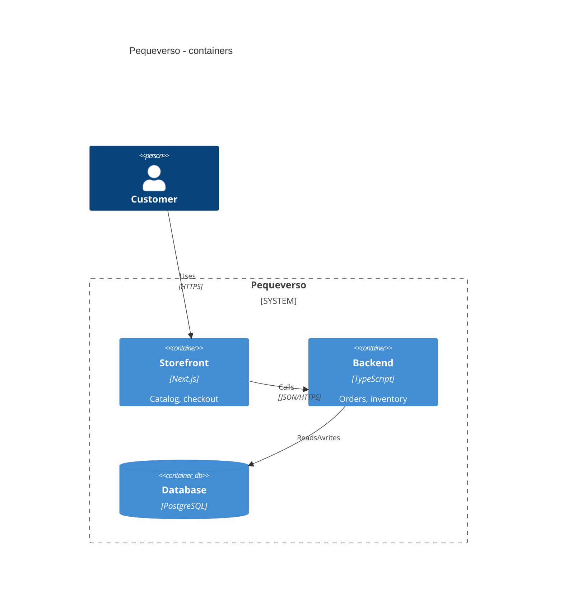

# 08 - Repository documentation and agent-facing docs, best practice 2026

Date: 2026-11-09. Scope: 7 repos (3 public portfolio, 3 private Pequeverso, 1 private vps-ops). Method: WebFetch of primary docs plus targeted searches. The WebSearch budget ran out midway, so Spanish/English policy, Starlight/Docusaurus comparisons, and mkdocstrings status rest on prior knowledge and are labelled as such. Sources marked [C] have a commercial interest; the list is at the end.

## 0. Executive recommendations

1. One README template (section 2), two variants: PUBLIC (recruiter-facing, with demo/proof) and PRIVATE (same skeleton, "Proprietary" license, ops/runbook links in place of demo).
2. Keep README to the human story; put agent instructions in `AGENTS.md` (short, commands and boundaries only). `CLAUDE.md` = `@AGENTS.md` import plus Claude-only notes. This matches the existing workspace setup.
3. Diagrams as code: Mermaid C4 (renders natively on GitHub) for L1/L2 in README; add Structurizr DSL only where a model is shared across many views.
4. ADRs in MADR 4 under `docs/decisions/`; Keep a Changelog + SemVer; Conventional Commits drive both.
5. Skills: `.agents/skills/<name>/SKILL.md` canonical; per-skill symlinks in `.claude/skills/`. Every skill ships `evals/` with a trigger bank (about 20 queries) and 2-3 output evals (section 4).
6. Docs CI: lychee (links), markdownlint-cli2 (structure), Vale (prose, English only), skills validator. Run on PR plus weekly cron for links.
7. Do not adopt mkdocs-material for new docs sites; evaluate Zensical or a plain `docs/` folder rendered by GitHub. For 7 solo repos, GitHub-rendered Markdown is enough.

## 1. README as showcase

### 1.1 What reviewers actually do

Career-advice sources (no recruiter survey exists in what I found; treat as opinion, several are recruiting vendors [C]) converge on: 30-90 seconds per profile; pinned repos first; open one or two repos; read the README before code; only then commits, tests, structure ([techinterview.org][52], [underdog.io][53] [C]). Their repeated asks:

- One-sentence "what is this" at the top; the "why" (problem and key design choice) shows product judgment.
- Run path that works first time; a live demo or screenshot/GIF is called "one of the highest-value additions."
- Architecture snapshot (diagram) and honest status (active/experimental/archived).
- Engineering habits visible: tests, CI, scoped commit messages, PR descriptions.
- Abandonment signals: WIP with no recent commits, template boilerplate, empty Contributing/License sections.
- "Three or four polished repos beat six mixed ones"; GitHub allows 6 pins. This number is blogger opinion, not data.

For a solo AI engineer: add an "Evaluation" or "Results" section (eval numbers, cost/latency, failure modes). That is the AI-specific proof hiring managers cannot get from a profile.

### 1.2 Structure of top READMEs

FastAPI's README ([27]) is the canonical model: centered logo plus one-line tagline, only 4 badges (tests, coverage, version, Python versions), key features, social proof, a minimal runnable example that grows incrementally, screenshots of the result, then License. Progressive disclosure and visual proof are the transferable lessons.

### 1.3 Make a README and standard-readme

- Make a README ([26]): name, description, badges, visuals, install, usage, support, roadmap, contributing, authors, license, project status. Advice: "too long is better than too short" but push detail to docs; state project status at the top if slowed.
- standard-readme ([25]) is stricter and package-oriented: order Title, Banner, Badges, Short Description, Long Description, TOC, Security, Background, Install, Usage, Extra, API, Maintainers, Thanks, Contributing, License. Required: Title, Short Description, TOC (unless under 100 lines), Install, Usage, Contributing, License. Badges: no own heading, newline-delimited, prefer hosting static badges locally. Verdict: borrow its ordering discipline and the "short description under about 120 chars" rule; do not adopt it verbatim (no demo/architecture/evaluation slots, and no ADR slot).
- GitHub renders an auto-outline for any Markdown file, so a manual TOC is optional below about 150 lines ([28]). README beyond 500 KiB is truncated; relative links are rebased per branch.

### 1.4 Badges policy (recommendation)

Fewer than 5, one row, no heading. Allowed: CI status (own workflow, the only dynamic badge that proves something), license, language/runtime version, release/version (if published), coverage (only if gated in CI). Banned: visitor counters, "made with" vanity badges, stars/forks, third-party "quality score" services, anything that 404s. Prefer GitHub's native workflow badge over shields.io for CI. shields.io ([51]) is donation-funded and can be self-hosted; its endpoints are an external request on every README view (privacy trade-off noted by standard-readme). Private repos: omit badges except CI.

### 1.5 Light/dark images

Use `<picture>` with `prefers-color-scheme` ([29], GitHub blog). The older `#gh-dark-mode-only` fragment is reported deprecated by secondary sources; I did not find a GitHub statement, so avoid it. Keep Mermaid in fenced blocks where possible: GitHub themes it automatically ([30]).

## 2. Proposed unified README template

```markdown
<div align="center">
  <picture>
    <source media="(prefers-color-scheme: dark)" srcset="docs/assets/logo-dark.svg">
    
  </picture>

# PROJECT_NAME
**One sentence: what it is and for whom (max 120 chars).**

[](https://github.com/OWNER/REPO/actions/workflows/ci.yml)
   <!-- PRIVATE: omit, or "proprietary" -->

</div>

> **Status:** active | experimental | maintenance | archived. Last meaningful update: YYYY-MM.
> **Visibility:** public portfolio | private (Pequeverso) | private (ops).

## Why
Problem, who has it, and the one key design choice (3-5 lines). Link: ADR index (`docs/decisions/`).

## Demo / Proof            <!-- PRIVATE: replace with "Where it runs" (URLs, environments) -->
Screenshot or GIF (light/dark), live link, and 2-4 measured results
(latency, eval pass rate, cost per run, test count). Numbers carry a date and a command to reproduce.

## Architecture
C4 level 1 or 2 as Mermaid (see section 3). Two sentences on boundaries. Link to `docs/architecture.md`.

## Quickstart
Prereqs (versions from `.nvmrc` / `pyproject.toml`), then at most 5 copy-pasteable commands.
Expected output in one line. Secrets: copy `.env.example` to `.env.local` (never commit).

## Usage
Smallest realistic example. Link to `docs/` for how-tos.

## Tech stack
One line per layer, with versions only where they matter.

## Quality
How to run tests / lint / evals (the same commands as AGENTS.md). CI link. Eval summary if AI.

## Documentation
| Need | Where |
|---|---|
| Learn it (tutorial) | docs/tutorials/ |
| Do a task (how-to) | docs/how-to/ |
| Look up (reference) | docs/reference/ |
| Understand why (explanation, ADRs) | docs/explanation/, docs/decisions/ |
| Agents | `AGENTS.md`, `.agents/skills/` |

## Roadmap
3-5 bullets, linked to issues. Say what is deliberately not planned.

## Contributing / Security / Support
One line each linking CONTRIBUTING.md, SECURITY.md (private vulnerability reporting), SUPPORT.md.
Solo-maintainer note: expected response time.

## License
MIT (public) | "All rights reserved" (private).
```

Rules: 60-150 lines; every section present in every repo (write "n/a: reason" rather than deleting, so the 7 stay structurally identical); no emoji headings; same section names, same order; `Why` and `Proof` are never empty on public repos. Private variants swap Demo for "Where it runs" and may link to internal runbooks.

## 3. Documentation architecture

### 3.1 Diataxis

Four forms: tutorials, how-to guides, reference, explanation ([34]). Apply it as a folder convention (`docs/{tutorials,how-to,reference,explanation}`) only once a repo has more than about 6 doc files; otherwise one `docs/architecture.md` and `docs/decisions/` suffice. The site itself advises incremental adoption rather than a big restructure. Diataxis maps cleanly to agent docs too: AGENTS.md = reference for agents; skills = how-to for agents.

### 3.2 C4 and diagrams as code

C4 ([31], Simon Brown; site sells books/training [C]) has four levels (context, container, component, code) plus landscape/dynamic/deployment. Rule of thumb for solo repos: draw L1 and L2 only; L3 only for the one complex container; never L4.

Options:

- Mermaid C4 ([33]): renders on GitHub with no tooling. Limits: layout not automatic (statement order drives position), no sprites, tags, links or legends; GitHub's bundled Mermaid version may lag (check with a code block containing only `info`, [30]). Treat as good-enough for README.
- Structurizr DSL ([32]): one model, many views; CLI exports PlantUML, Mermaid, static site, PNG/SVG; all commands free except the server product [C]. Use when two or more repos share a system model (the Pequeverso trio is a candidate: one `workspace.dsl` in a shared location, export Mermaid into each README).
- Light/dark: exported SVG pairs with the `<picture>` snippet; Mermaid needs nothing.
- Decision: Mermaid C4 in README for all 7; evaluate Structurizr for the Pequeverso system landscape only.

Example (README-ready):

````markdown

````

### 3.3 ADRs with MADR 4

MADR 4.0.0 released 2024-09-17 ([20]); ADR background and Nygard origin at [21]. Template: front matter (`status`, `date`, `decision-makers`, `consulted`, `informed`), title, Context and Problem Statement, Decision Drivers, Considered Options, Decision Outcome (with Consequences and Confirmation), Pros and Cons, More Information. Variants: full, minimal, bare. "Confirmation" (how compliance is verified, ideally a test or lint rule) is the 4.x feature worth using, since it ties decisions to checks.

Policy: `docs/decisions/NNNN-kebab-title.md`, minimal template by default, full for risky/structural choices; status transitions via new ADR "supersedes"; one ADR per decision, written in the PR that implements it. For a solo repo, aim for 3-8 ADRs total in the first year (framework, data store, auth, hosting, eval strategy, agent architecture).

```markdown
---
status: accepted
date: 2026-11-09
decision-makers: gonzalomartinperez
---
# Use Postgres row-level security for tenant isolation

## Context and Problem Statement
...
## Considered Options
* RLS in Postgres
* Application-layer filtering
## Decision Outcome
Chosen option: "RLS", because ... 
### Consequences
* Good: ... * Bad: ...
### Confirmation
`tests/rls.spec.ts` fails if a policy is missing.
```

### 3.4 Changelog and versioning

Keep a Changelog 1.1.0 ([22]): `CHANGELOG.md`, newest first, ISO dates, sections Added/Changed/Deprecated/Removed/Fixed/Security, `Unreleased` on top, `[YANKED]` marker. SemVer ([23]): 0.y.z means unstable; releases immutable; pre-release `-rc.1`. Conventional Commits ([24]) map `fix` to PATCH, `feat` to MINOR, `!`/`BREAKING CHANGE` to MAJOR. Apps (the storefront) need not use SemVer strictly; use date or release-branch tags and keep the changelog as the human release record. Do not auto-generate a changelog from commits and publish it unedited ("changelogs are for humans").

### 3.5 Code-level docs

- TypeScript: TSDoc comments plus TypeDoc ([42]); generates HTML/JSON from exports and entry points. I could not confirm TypeDoc's validation flags from the fetched page; verify `validation` and `treatWarningsAsErrors` in its option docs before gating CI. Document only exported/public API; comments explain intent, not types.
- Python: Google style docstrings ([43]): summary line one physical line, Args/Returns/Raises, Attributes for classes; required for public API and non-obvious functions; "enough to write a call without reading the code." Enforce with Ruff `D` rules and `convention = "google"`.
- Doc sites: mkdocs-material entered maintenance mode on 2025-11-05; feature work moved to Zensical ([35], [36]). Support end date is contested (section 8). Zensical is MIT, Rust+Python, reads `mkdocs.yml`, supports only a subset of plugins, no feature parity yet; paid "Zensical Spark" membership exists [C]. Insiders features were made free in Nov 2025 ([37]). Alternatives (Starlight, Docusaurus, Fumadocs, Sphinx) were not researched this session due to the search cap. Recommendation: no doc site for 6 of 7 repos; if one is needed, start on Zensical or Starlight, avoid mkdocs-material for new work.

### 3.6 Docs testing

- lychee ([38]): Rust link checker for Markdown/HTML; `--offline` for local-only; `--cache` (off by default); `lychee.toml`; `.lycheeignore`; set `GITHUB_TOKEN` to avoid rate limits. Action `lycheeverse/lychee-action@v2` ([39]) with cache steps; pin to a commit SHA per its own guidance. Run offline on PRs (fast, no flakes), full online on weekly cron that opens an issue.
- markdownlint-cli2 ([40]): `.markdownlint-cli2.jsonc`, `--fix` edits in place with no backup, exit codes 0/1/2, action exists. Disable MD013 (line length) and MD033 (inline HTML) because README uses `<picture>`/`<div>`.
- Vale ([41]): prose linter, MIT, Go; error-level rules fail CI; `vale-action`. Use with the Google or Microsoft style packages for English docs. Spanish rule coverage was not verified; do not run Vale on Spanish files until confirmed.
- Also: a skill validator (section 4), and a repo script that checks AGENTS.md commands exist (grep `package.json` scripts) to prevent rot.

Minimal CI job:

```yaml
name: docs
on: { pull_request: { paths: ["**/*.md", ".agents/**", "docs/**"] }, schedule: [{ cron: "0 6 * * 1" }] }
permissions: { contents: read }
jobs:
  docs:
    runs-on: ubuntu-latest
    steps:
      - uses: actions/checkout@v5
      - uses: DavidAnson/markdownlint-cli2-action@v19   # pin by SHA in practice
      - uses: lycheeverse/lychee-action@v2
        with: { args: "--offline --no-progress '**/*.md'" }
```

### 3.7 Spanish/English policy (my recommendation, unsourced)

- English: README, AGENTS.md, CLAUDE.md, skills, ADRs, code comments, commit messages, CHANGELOG, issue/PR templates, SECURITY/CONTRIBUTING. Reason: recruiters, tooling (Vale, agents' instruction following), and consistency across 7 repos.
- Spanish allowed: owner-facing Pequeverso operational copy (marketing, runbooks written for the owner) kept in clearly named files (`docs/es/` or `*.es.md`), plus an optional `README.es.md` on public repos with a language switch line at the top.
- Never mix languages inside one file apart from product copy/examples. Run prose lint on English only.

## 4. GitHub community health and the shared `.github` repo

- Defaults ([45]): a public `.github` repo supplies CODE_OF_CONDUCT, CONTRIBUTING, FUNDING.yml, issue/PR templates and config.yml, SECURITY.md, SUPPORT.md, discussion forms. Precedence: repo's own `.github/`, then root, then `docs/`, then the account default. Limits: the default repo must be public (cannot be private); you cannot default a LICENSE; if a repo has any issue template of its own, none of the defaults apply (all-or-nothing); labels used by templates must exist in each repo. Whether defaults apply to the owner's private repos was not stated explicitly in the page; test with one private repo before relying on it.
- Community profile checklist ([48]) for public repos: README, CODE_OF_CONDUCT, LICENSE, CONTRIBUTING, security policy, issue templates (valid `name`/`description` keys for forms).
- SECURITY.md ([49]): supported versions plus how to report. Enable private vulnerability reporting (owners/admins of public repos; reporters get a form with summary, details, PoC, impact; GitHub rate-limits reports) ([44]). It is independent of SECURITY.md, which GitHub shows above the form. For private repos, SECURITY.md is still useful to agents; PVR availability on private repos was not confirmed.
- CODE_OF_CONDUCT ([50]): Contributor Covenant 3.0 includes an enforcement ladder and requires a reporting channel and named moderators. For solo repos this is mostly a checklist signal; adopt the shared one from `.github` with your contact email, do not copy it into each repo, and skip it entirely for private repos.
- CONTRIBUTING: short for solo repos: how to run checks (same commands as AGENTS.md), branch flow (develop to main), commit convention, "issues first for large changes." Link from README only.
- Issue forms (YAML) ([46]): `bug.yml`, `feature.yml`; `config.yml` with `blank_issues_enabled: false` and contact links. PR template: summary, linked issue, test evidence, docs/changelog touched, risk. Keep each under about 25 lines.
- CODEOWNERS ([47]): `.github/CODEOWNERS` with `* @gonzalomartinperez`, and protect the file itself; last matching pattern wins; owners need explicit write access. For a solo owner it only matters if a ruleset requires code-owner review, which would block self-merge; skip enforcement, keep the file as a map.
- SUPPORT.md: one paragraph (issues, response expectation, no SLA).
- Shared repo contents to create: `gonzalomartinperez/.github` with `profile/README.md` (profile README), `CODE_OF_CONDUCT.md`, `SECURITY.md`, `SUPPORT.md`, `.github/ISSUE_TEMPLATE/*`, `PULL_REQUEST_TEMPLATE.md`, plus a `templates/` folder holding README, ADR, AGENTS.md and SKILL.md skeletons (not auto-applied, copied by a sync script). Note a per-repo SECURITY.md/templates override defaults completely, so private repos need their own copies where defaults do not reach.

## 5. Agent-facing docs

### 5.1 AGENTS.md standard

Plain Markdown at repo root, no required fields, nearest file wins in monorepos, explicit chat prompts override ([10]). Stewarded by the Agentic AI Foundation (AAIF), a Linux Foundation directed fund formed 2025-12-09 with MCP, goose and AGENTS.md ([11], [12] [C]: OpenAI/Anthropic/Block are founders and vendors). Supported by Codex, Cursor, Copilot, Gemini CLI, Jules, Aider, Zed, Windsurf, Devin and others. Migration tip: rename and symlink the old name.

Claude Code specifics ([7]): reads AGENTS.md only when no CLAUDE.md exists in the working directory or above; if both exist it reads CLAUDE.md only, so the pattern is `CLAUDE.md` containing `@AGENTS.md` (this workspace already does it). Imports max 4 hops, load with the file (no context saving). Target under 200 lines; contradictions are resolved arbitrarily; `/doctor prompt-audit` finds stale references and conflicts. Direct AGENTS.md reading needs a recent Claude Code version (the page cites v2.1.277); verify locally.

### 5.2 What goes in (and the evidence)

GitHub's analysis of 2,500+ repos ([16] [C]): six areas: commands, testing, project structure, code style, git workflow, boundaries; commands early with flags; real code example over prose; three-tier boundaries (always / ask first / never); name stack with versions.

Counter-evidence: arXiv 2602.11988 (ICLR 2026) found repo context files tended to reduce task success and raise inference cost by over 20%; they do not work as repo overviews; LLM-generated files help only when docs are otherwise absent; advice is human-written, minimal, critical requirements only ([13]). A secondary summary reports a small gain (about 4%) for developer-written files; I did not verify that against the paper. HumanLayer ([15] [C]) recommends WHY/WHAT/HOW, under about 300 lines (theirs under 60), no style rules (use linters/hooks), no auto-generation, point to `file:line`. Vercel ([14] [C]) measured an AGENTS.md docs index at 100% vs skills at 53% (default) and 79% (with explicit instruction) in Next.js evals: skills went uninvoked in 56% of cases.

Synthesis: AGENTS.md should be short (target 40-100 lines), contain only what the agent cannot infer from code, and be verified by evals or by actually removing lines and seeing nothing break. Put always-needed facts in AGENTS.md; put procedures in skills; enforce hard rules with hooks/permissions, not prose ([7] says CLAUDE.md is context, not enforcement).

AGENTS.md skeleton (public or private repo):

```markdown
# AGENTS.md
## Commands            <!-- exact, with flags; CI runs the same -->
- Install: `pnpm i --frozen-lockfile`  - Test: `pnpm test`  - Lint/types: `pnpm lint && pnpm typecheck`
## Layout              <!-- only non-obvious: where X lives, generated dirs not to edit -->
## Conventions         <!-- only deviations from defaults; link to ADRs -->
## Boundaries
- Always: run tests before saying done; keep `CHANGELOG.md` Unreleased current.
- Ask first: new dependency, schema migration, public API change.
- Never: commit secrets (`.env.local`), edit `dist/`, force-push main.
## Skills                <!-- name: one-line trigger. Passive pointer helps activation (Vercel) -->
## Docs map             <!-- README, docs/decisions, architecture -->

```

### 5.3 Agent Skills open standard

Spec ([2]): directory with `SKILL.md`; frontmatter `name` (max 64 chars, lowercase/digits/hyphens, no leading/trailing/consecutive hyphens, must equal directory name), `description` (1-1024 chars; what and when), optional `license`, `compatibility` (max 500), `metadata` (string map), `allowed-tools` (experimental). Optional `scripts/`, `references/`, `assets/`. Progressive disclosure: metadata about 100 tokens at startup; body under 5,000 tokens recommended and under 500 lines; resources on demand; references one level deep. Validate with `skills-ref validate`. Anthropic published it as an open standard ([5], [6]).

Anthropic best practices ([1]): concise (assume the model is smart), third-person descriptions, gerund or noun-phrase names, avoid vague names and reserved words (`anthropic`, `claude`), degrees of freedom matched to fragility, feedback loops (validate then fix), TOC for reference files over 100 lines, utility scripts execute rather than load, avoid time-sensitive text, use consistent terminology, forward-slash paths, fully qualified MCP tool names (`Server:tool`), at least three evaluations before sharing, test on Haiku, Sonnet and Opus. Anthropic states no built-in eval runner exists; build your own.

Claude Code additions ([8]): project skills in `.claude/skills/`; frontmatter extras (`when_to_use`, `disable-model-invocation`, `user-invocable`, `paths`, `context: fork`, `allowed-tools`, `model`, `effort`, `hooks`); `description` plus `when_to_use` truncated at 1,536 chars in the listing, key use case first; unknown fields are ignored; skill folders may be symlinks. The page did not mention `.agents/skills`.

Cross-agent paths: Codex scans `.agents/skills` from cwd up to repo root, follows symlinks, per-skill implicit invocation toggle via `agents/openai.yaml` ([17] [C]); Gemini CLI reads `.gemini/skills` and alias `.agents/skills` (alias wins within tier) ([18]); Copilot reads `.github/skills`, `.claude/skills`, `.agents/skills` ([19]). Therefore: canonical `.agents/skills/<name>/`, and `.claude/skills/<name>` as a relative symlink (`ln -s ../../.agents/skills/<name> .claude/skills/<name>`). Stay within the portable frontmatter subset; put Claude-only keys under the same file only if harmless elsewhere (others ignore or warn; verify per tool). Git stores symlinks fine on Linux/WSL; avoid Windows checkouts.

### 5.4 Skills standard for these repos

- Naming: `verb-ing-noun` or noun phrase, matching directory; repo-prefix only for repo-specific skills (`pequeverso-release`).
- Scope: one job per skill; split when the description needs "and" twice.
- Description formula, under 1024 chars, imperative and third-person-compatible: "<Does X>. Use when <user intents incl. indirect phrasings>, even if <keyword absent>. Do not use for <near-miss neighbor>." Key trigger first (listing truncation).
- Body: under 150 lines typical, hard cap 500; steps, one default (not option menus), verification step, link `references/*.md` one level deep.
- Determinism: put fragile steps in `scripts/` with clear errors.
- Safety: no network calls or secrets in skills; review any third-party skill before install ([5] warns of exfiltration risk).
- Ownership: `metadata: {owner, last-reviewed: YYYY-MM-DD, version}`.
- CI: validate frontmatter and name==dirname, length limits, link integrity, and a staleness check on `last-reviewed` (older than 180 days opens an issue).

### 5.5 Activation eval format

Based on the open spec's guidance ([4] trigger evals, [3] output evals). Layout per skill:

```
.agents/skills/deploying-previews/
  SKILL.md
  evals/
    triggers.json     # description tests
    evals.json        # output-quality tests
    files/            # fixtures
```

`triggers.json` (about 20 queries; 8-10 positive, 8-10 near-miss negatives; fixed 60/40 train/validation split recorded in the file):

```json
{
  "skill": "deploying-previews",
  "split_seed": 7,
  "queries": [
    {"id": "t01", "split": "train", "should_trigger": true,
     "query": "can u get a preview of this branch up so the owner can click through it"},
    {"id": "t02", "split": "validation", "should_trigger": false,
     "query": "roll back prod to yesterday's build"}
  ]
}
```

Protocol: run each query 3 times on a clean context with the skill installed, detect activation from the client's log (for Claude Code, a `Skill` tool_use with that name; for Codex check skill loads in its logs); trigger rate = activations/runs; pass if rate >= 0.5 for positives, < 0.5 for negatives. Report precision/recall on validation only; choose the best iteration by validation score, at most about 5 iterations ([4]). Add 3 near-miss negatives that mention sibling skills in the same repo. Also test with an explicit AGENTS.md pointer, since Vercel measured activation rising to 95%+ with explicit instruction ([14]).

`evals.json` (output quality, each run with skill vs without skill or previous snapshot, from [3]):

```json
{"skill_name": "deploying-previews", "evals": [
  {"id": 1, "prompt": "...", "expected_output": "...", "files": ["evals/files/x"],
   "assertions": ["runs the typecheck before deploying", "prints the preview URL", "does not touch production env"]}
]}
```

Grade with evidence quotes (PASS needs evidence); drop assertions that pass both with and without the skill; record `timing.json` tokens/duration and `benchmark.json` delta; human-review with a short `feedback.json`. Run on cheap and strong models (Anthropic: Haiku, Sonnet, Opus). Gate: no merge of a skill change if validation trigger accuracy drops by more than 10 points or output pass-rate delta turns negative. The skill-creator skill ([6]) automates much of this loop. Note cost: 60 invocations per skill per iteration; run only on changed skills.

### 5.6 Keeping agent docs from rotting

- Single source: AGENTS.md commands must equal CI commands; a test greps each backticked command against `package.json`/Makefile.
- Dated and owned: `last-reviewed` in skill metadata; monthly `/doctor prompt-audit` ([7]) and manual removal pass (delete a line, run evals, keep deleted if nothing regresses).
- Never put volatile facts (versions, counts, URLs of environments) in AGENTS.md; link to the source file (`file:line`, [15]).
- Do not paste LLM-generated overviews ([13], [15]).
- Corrections loop: when an agent fails twice on something, fix with a script, lint rule, or hook first; add prose only if that is impossible.
- Review agent files in the same PR that changes the behavior they describe (PR template checkbox).
- Hard rules go to hooks or `permissions.deny`, not prose ([7]).

## 6. Rollout plan (one pass across 7 repos)

1. Create `gonzalomartinperez/.github` (public): CoC, SECURITY, SUPPORT, issue forms, PR template, profile README, `templates/`.
2. Per repo: README from template; AGENTS.md; `CLAUDE.md` = `@AGENTS.md`; `docs/decisions/0001-*.md`; CHANGELOG.md; LICENSE; `.github/workflows/docs.yml`; `.markdownlint-cli2.jsonc`; `lychee.toml`.
3. Enable private vulnerability reporting on the 3 public repos; check availability for private ones.
4. Skills: migrate existing skills to `.agents/skills` + symlinks; add `evals/` for any skill used weekly; leave rarely used ones without evals but with validator.
5. Pin 3-4 public repos; archive or privatize anything weak.
6. Acceptance: a fresh clone passes docs CI; README top 20 seconds answers what/why/how-to-try.

## 7. Source reliability notes

- Strong (primary/spec): [1]-[9], [17]-[24], [28]-[32], [35], [38]-[50].
- Vendor-interested findings: Vercel [14], GitHub blog [16], OpenAI/AAIF posts [12], HumanLayer [15], Zensical Spark [35]/[36], Structurizr server [32], c4model.com [31], recruiting-vendor blogs [52], [53].
- Weak: career-blog claims about recruiter time and pin counts (no survey).

## 8. Contested / uncertain

- mkdocs-material support end date: one source says the critical-fix window ended 2026-11-05; Material's own blog (as fetched) says critical fixes until 2027-05-05. Today is 2026-11-09; check the live announcement before deciding. Either way, no new features.
- Zensical maturity: official pages say it builds supported Material projects but plugin support is partial and parity not reached; the get-started page did not state alpha/beta/stable. Do not assume mkdocstrings (Python API docs) works.
- AGENTS.md value: ICLR 2026 paper says context files often hurt; Vercel and GitHub say a good one helps. Likely reconcilable: terse, non-redundant, verified content helps; verbose or generated overviews hurt. Different benchmarks (SWE-bench Lite vs Next.js APIs).
- AGENTS.md donor attribution: Linux Foundation/OpenAI say OpenAI contributed it; others say OpenAI and Anthropic jointly. Irrelevant to usage.
- Skills vs AGENTS.md for always-needed knowledge: Vercel data (single framework, vendor) favors passive AGENTS.md index; skills win for procedural, on-demand work. Keep both, test activation.
- `.agents/skills` in Claude Code: not documented on the fetched page; use symlinks into `.claude/skills`. Whole-directory symlink (`.claude/skills -> ../.agents/skills`) is unverified; per-skill symlinks are documented.
- `.github` defaults and private repos: not stated; and PVR on private repos not confirmed.
- Light/dark `#gh-dark-mode-only` deprecation: secondhand only.
- Spanish Vale support, TypeDoc validation flags, Starlight/Docusaurus comparison, shields.io exact privacy behavior, and GitHub Mermaid version lag: not verified.
- Recruiter behavior numbers (30-90 s; 3-4 pins): blog opinion; no 2025-2026 survey found.
- Gemini CLI page notes it was replaced by Antigravity CLI for some tiers on 2026-06-18; `.agents/skills` support there not checked.
- Claude Code version requirement for direct AGENTS.md read (v2.1.277 per docs) should be checked against the installed version.

## 9. Sources

[1] Anthropic, Skill authoring best practices - https://platform.claude.com/docs/en/agents-and-tools/agent-skills/best-practices
[2] Agent Skills specification - https://agentskills.io/specification
[3] Agent Skills, Evaluating skill output quality - https://agentskills.io/skill-creation/evaluating-skills
[4] Agent Skills, Optimizing descriptions - https://agentskills.io/skill-creation/optimizing-descriptions
[5] Anthropic Engineering, Equipping agents with Agent Skills - https://www.anthropic.com/engineering/equipping-agents-for-the-real-world-with-agent-skills
[6] anthropics/skills (repo, skill-creator, template) - https://github.com/anthropics/skills
[7] Claude Code, memory / CLAUDE.md / AGENTS.md - https://code.claude.com/docs/en/memory
[8] Claude Code, Skills - https://code.claude.com/docs/en/skills
[9] Claude Code, Best practices - https://code.claude.com/docs/en/best-practices (fetched; large, only skimmed)
[10] AGENTS.md - https://www.agents.md
[11] Linux Foundation AAIF press release - https://www.linuxfoundation.org/press/linux-foundation-announces-the-formation-of-the-agentic-ai-foundation
[12] OpenAI, Agentic AI Foundation [C] - https://openai.com/index/agentic-ai-foundation/
[13] Evaluating AGENTS.md (arXiv 2602.11988, ICLR 2026) - https://arxiv.org/abs/2602.11988
[14] Vercel, AGENTS.md outperforms skills in our agent evals [C] - https://vercel.com/blog/agents-md-outperforms-skills-in-our-agent-evals
[15] HumanLayer, Writing a good CLAUDE.md [C] - https://www.humanlayer.dev/blog/writing-a-good-claude-md
[16] GitHub Blog, How to write a great agents.md [C] - https://github.blog/ai-and-ml/github-copilot/how-to-write-a-great-agents-md-lessons-from-over-2500-repositories/
[17] OpenAI Codex, skills [C] - https://learn.chatgpt.com/docs/build-skills
[18] Gemini CLI, skills - https://geminicli.com/docs/cli/skills/
[19] GitHub Copilot, agent skills - https://docs.github.com/en/copilot/concepts/agents/about-agent-skills
[20] MADR - https://adr.github.io/madr/
[21] ADR GitHub organization - https://adr.github.io/
[22] Keep a Changelog 1.1.0 - https://keepachangelog.com/en/1.1.0/
[23] Semantic Versioning - https://semver.org/
[24] Conventional Commits 1.0.0 - https://www.conventionalcommits.org/en/v1.0.0/
[25] standard-readme spec - https://github.com/RichardLitt/standard-readme/blob/main/spec.md
[26] Make a README - https://www.makeareadme.com/
[27] FastAPI README - https://raw.githubusercontent.com/tiangolo/fastapi/master/README.md
[28] GitHub Docs, About READMEs - https://docs.github.com/en/repositories/managing-your-repositorys-settings-and-features/customizing-your-repository/about-readmes
[29] GitHub Blog, light/dark images - https://github.blog/developer-skills/github/how-to-make-your-images-in-markdown-on-github-adjust-for-dark-mode-and-light-mode/
[30] GitHub Docs, Creating diagrams - https://docs.github.com/en/get-started/writing-on-github/working-with-advanced-formatting/creating-diagrams
[31] C4 model [C: books/training] - https://c4model.com/
[32] Structurizr docs [C: server licence] - https://docs.structurizr.com/
[33] Mermaid C4 - https://mermaid.js.org/syntax/c4.html
[34] Diataxis - https://diataxis.fr/
[35] Material for MkDocs blog, Zensical transition [C] - https://squidfunk.github.io/mkdocs-material/blog/2025/11/05/zensical/
[36] Zensical docs [C] - https://zensical.org/docs/get-started/
[37] Material for MkDocs, Insiders free for everyone (via search) - https://squidfunk.github.io/mkdocs-material/blog/2025/11/11/insiders-now-free-for-everyone/
[38] lychee - https://github.com/lycheeverse/lychee
[39] lychee-action - https://github.com/lycheeverse/lychee-action
[40] markdownlint-cli2 - https://github.com/DavidAnson/markdownlint-cli2
[41] Vale - https://docs.vale.sh/
[42] TypeDoc - https://typedoc.org/
[43] Google Python Style Guide - https://google.github.io/styleguide/pyguide.html
[44] GitHub Docs, Privately reporting a vulnerability - https://docs.github.com/en/code-security/security-advisories/guidance-on-reporting-and-writing-information-about-vulnerabilities/privately-reporting-a-security-vulnerability
[45] GitHub Docs, Default community health file - https://docs.github.com/en/communities/setting-up-your-project-for-healthy-contributions/creating-a-default-community-health-file
[46] GitHub Docs, Issue templates - https://docs.github.com/en/communities/setting-up-your-project-for-healthy-contributions/configuring-issue-templates-for-your-repository (fetch returned 404; content from search/known docs, not verified this session)
[47] GitHub Docs, CODEOWNERS - https://docs.github.com/en/repositories/managing-your-repositorys-settings-and-features/customizing-your-repository/about-code-owners
[48] GitHub Docs, Community profiles - https://docs.github.com/en/communities/setting-up-your-project-for-healthy-contributions/about-community-profiles-for-public-repositories
[49] GitHub Docs, Security policy - https://docs.github.com/en/code-security/getting-started/adding-a-security-policy-to-your-repository
[50] Contributor Covenant 3.0 - https://www.contributor-covenant.org/version/3/0/code_of_conduct/
[51] shields.io - https://shields.io/
[52] TechInterview, GitHub profile polish [C: advice site, no disclosure found] - https://www.techinterview.org/post/3233474626/github-profile-engineers/
[53] Underdog.io, what hiring managers look for [C: recruiting marketplace] - https://underdog.io/blog/what-hiring-managers-look-for-on-github
[54] Search-only (not fetched): Instahyre GitHub checklist [C], reskilll guide [C], DEV posts on README dark mode, duerrenberger.dev on Zensical, pydevtools Material reference.
