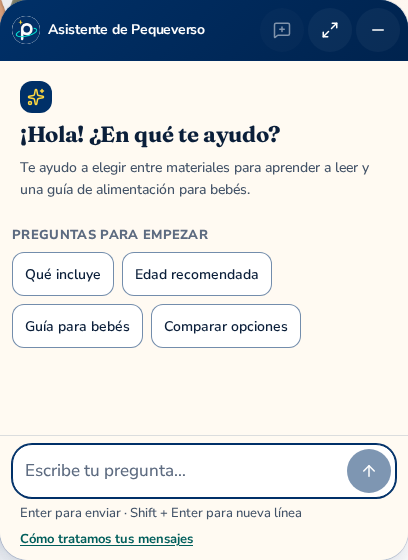
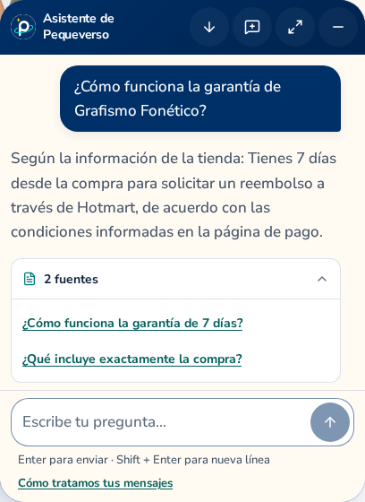
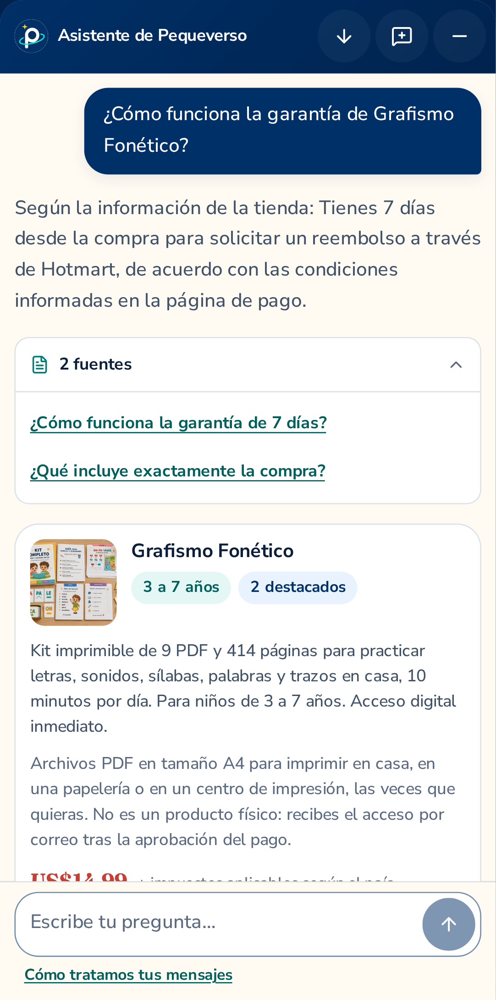

# Native assistant panel details · 2026-10-18

**Production assistant remains disabled. The enabled local fixture is not publishable or
VPS-deployed.** These three unedited PNGs are native locator screenshots of the actual
Spanish interface with an isolated fixture provider. They do not show real-model answers.

| Desktop welcome · 408 × 560 image pixels | Desktop guarantee answer · 408 × 560 image pixels |
| :---: | :---: |
|  |  |

The mobile original is 1082 × 2181 image pixels, displayed here at 360 pixels wide.
The scrollable product card continues below the visible conversation area; the fixed composer
is visible. These dimensions describe PNG pixels, not an inferred CSS viewport. Neither
bitmap resizing nor image editing was applied; links open the complete original bytes.

The source pair is Store `755d541a86389703665e65c2b762aacfb6e345ad` and API
`2f22f24b30de7ee6a797d6397bef7422eb8e31cc`. The original isolated fixture build identifies
Store `755d541`, built at `2026-10-18T22:26:39.287Z`, with assistant enabled only for that
local export. The closeup run finished at `2026-10-18T23:16:02.841745+00:00`; this is a
later capture of that fixture, not a new build or a published API/source-main claim.

The [manifest](manifest.json) records all three SHA256 hashes, byte counts and dimensions.
The byte-preserved [Root visual and delivery receipt](ROOT-VISUAL-AND-DELIVERY.json) records
the source pair, actual finish, closed descendants/ports and production-disabled scope.
Root and this documentation agent opened all three originals: this is agent review, not
human review, accessibility certification or authenticated/model correctness proof.

The [seven original full-viewport captures](../../native-assistant-2026-10-18/README.md)
retain their existing bytes, provenance and historical timing. The
[dated API evidence report](../../api-evidence-2026-10-18.md) separates local fixture UI,
PostgreSQL/CI evidence and outstanding deployment/model gates. No real visitor data, keys,
provider calls or OAuth verification were used for this documentation increment.
