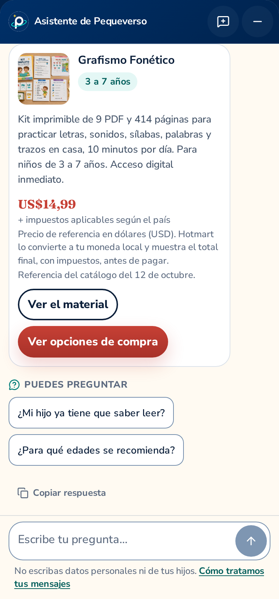
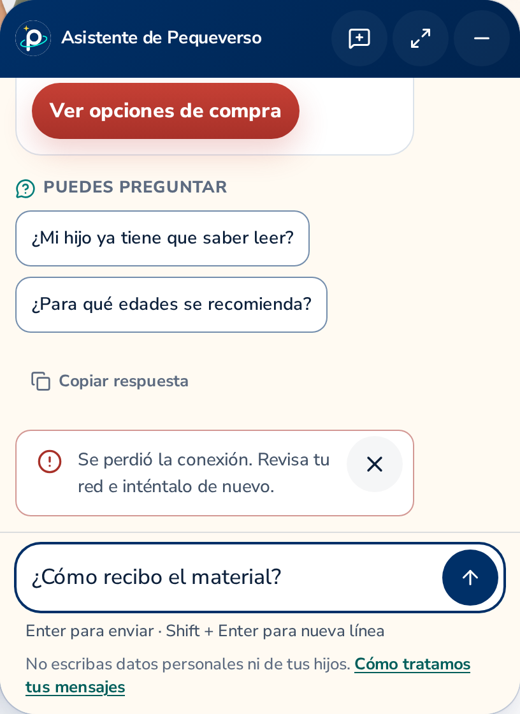

# Native assistant photographs and verification boundaries

These photographs show the actual rendered Pequeverso interface, with its own typography,
cream surfaces, navy controls, teal accents and star-only launcher. Desktop uses a 1440 × 1000
CSS px viewport and the default 408 × 560 CSS px compact panel; mobile uses 390 × 844 CSS px.
All images were captured at DPR 2 and individually inspected by root independently of the web
implementer. This is agent review, not human review. The storefront remains **disabled in
publishable builds**.

## Locally connected to the real provider

The three real-model photographs come from the authored question:
“¿Cómo se entrega después de comprarlo y dónde puedo consultar la garantía?”
The native storefront requested Spanish through v1 revision 1.4, with normal session cookies,
Origin, CSRF, HTTP/SSE and persistence. OpenAI used GPT-6 Luna at medium effort, with no
substitute model or generation retry. Its visible final text matched the HTTP-restored answer;
the completed replay passed the native SSE reader's framing, event order, run identity and
message checks, returned the same authoritative final and left provider accounting unchanged.

[](real-desktop-context.png)

| Complete response | Expanded sources |
| --- | --- |
| <a href="real-desktop-answer.png"></a> | <a href="real-desktop-sources.png"></a> |

Both source links and the final answer were independently reviewed against the frozen public
catalog. The sample is synthetic and non-personal; no customer conversation, secret,
session cookie, CSRF value or private provider instruction is published.

The photo probe dispatched exactly two real generations in two independent browser sessions.
The first result is preserved privately from SQLite after Playwright could not acquire the
original response body; it has no verified HTTP history/replay result and is not pictured as
a final here. The second completed the visible-final/history/replay checks and these photographs,
then the capturer's reload assertion failed. That original failure is preserved; **real-provider
reload and mobile recovery are not certified by this gallery**. Neither original raw native SSE
body nor a full provisional draft trace was recovered. No generation was repeated to repair a
photograph, and no third real request was dispatched.

The two calls reported 9,144 input / 1,366 output tokens, including 1,819 cached input, 7,319
cache-write input and 870 reasoning tokens. Their usage-derived Standard estimate is
USD 0.001616665; all evaluations together estimate USD 0.158865800, while the shared conservative
ledger accounts for USD 0.376257 across 282 attempts with no unknown usage. These are estimates
and reservations, not a verified invoice or account-wide monthly spend. The original
[303-turn socket evaluation](../real-model-2026-10-12.md) remains unchanged and separate.

## Fixture photographs of additional states

The welcome, provisional SSE draft, product card and network error below use a local
**fixture-mode API**, with paid AI disabled and no provider key. They verify interface states
and safe presentation; they do not show model understanding, provider availability or a VPS.

| Welcome and questions | Provisional fixture stream |
| --- | --- |
| <a href="fixture-desktop-welcome.png"></a> | <a href="fixture-desktop-streaming.png"></a> |

| Full product details on mobile | Safe network error and retained draft |
| --- | --- |
| <a href="fixture-mobile-product.png"></a> | <a href="fixture-desktop-error.png"></a> |

The product photograph shows a genuine scroll position, including its full summary, age range,
price caveats, catalog reference date and both permitted links. The price is a dated public-catalog
snapshot, not a merchant quote or proof of stock. The surrounding store and compact panel
were captured directly; there are no generated mockups, enlarged replacement layouts or collages.

## Exact provenance and reproduction

The [manifest](manifest.json) records every PNG's hash, original dimensions, provider mode and
source revisions. The three real-model photographs used storefront build `8865edd`
(presentation `ec32eb1`) and backend source `e7e3664` (integrated develop `b7dcb0c`).
The four fixture photographs were recaptured from storefront `3514aca`, with the same pinned
producer `b7dcb0c`; their catalog reference date reflects the snapshot, not merchant confirmation.
Later test/documentation commits do not relabel these capture sources. The catalog SHA256 is
`ddddf3d05182fc4f77fd1f26e5bbd621bb09f2fe1f4425ee82f536fd77559a76`.
Contract v1 revision 1.4 remains backward compatible for legacy clients.

For reproducible fixture photography, use the storefront's checked-in
`docs/verification/assistant/2026-10-12/capture.config.ts` and its isolated API checkout at
`tests/assistant/api-revision`:

```bash
uv sync --frozen                         # inside the isolated API checkout
# Inside the storefront, with the repository's Node version and npm ci completed:
npm run build:assistant-fixture
ASSISTANT_API_DIR=/path/to/isolated-api-checkout \
  npx playwright test -c docs/verification/assistant/2026-10-12/capture.config.ts
```

The enabled export is an unpublishable local verification artifact. Review any newly captured
images before publishing documentation. Reproducing a paid sample requires current owner
authorization, official pricing/model verification and the existing private shared budget;
it is excluded from CI. See [evaluation procedures](../../evaluation.md).

These photographs do not establish physical keyboard behavior, deployed HTTPS/CORS/cookies,
proxy SSE handling, provider interruption billing, production restoration, capacity or measured
sales conversion. Deployment belongs to vps-ops; activation requires separate owner authorization.
